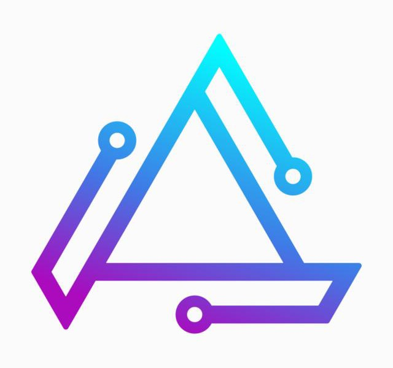

  

<h1 align="center">Auvora</h1>

<strong>One identity platform for authentication, authorization, federation, and machine, workload and AI-agent identity.</strong> It ships as a single Rust binary that needs only PostgreSQL to run.

---

> **Status:** Phase 0 (foundations). There is no usable release yet. Progress: [`docs/roadmap/STATUS.md`](docs/roadmap/STATUS.md). Phase plan: [`docs/product/plan.md`](docs/product/plan.md) §27.

## What Auvora aims to be

- **Superset coverage.** It covers what Keycloak, Zitadel, Ory, Auth0, WorkOS, Clerk, authentik and Entra each do in part, without copying their insecure shortcuts.
- **Embedded first.** OAuth 2.x/OIDC, SAML, SCIM, passkeys, MFA, RBAC + ABAC + ReBAC authorization, hooks, events, and LDAP/RADIUS gateways all run in one process. PostgreSQL is the only required dependency.
- **Human, machine and agent identity in one model**, with delegation and actor chains.
- **Every integration style from one engine:** hosted UI, drop-in components, headless Flow API or a fully self-hosted UI.
- **Provable security:** OIDF certification, fuzzed parsers, hash-chained audit and supervised (never silent) support access.

## Repository map

| Path | Contents |
|---|---|
| [`docs/`](docs/README.md) | Plan, architecture decisions (ADRs), specs, threat models, runbooks, docs site |
| [`crates/`](crates/README.md) | Rust server crates |
| [`ee/`](ee/README.md) | Enterprise Edition (commercial license) |
| [`apps/`](apps/README.md) | Admin console, hosted UI, org portal |
| [`packages/`](packages/README.md) | JavaScript/TypeScript SDKs and components |
| [`sdks/`](sdks/README.md) | SDKs for other languages |
| [`mobile/`](mobile/README.md) | Auvora Authenticator app |
| [`integrations/`](integrations/README.md) | Terraform provider, MCP server, plugins |
| [`deploy/`](deploy/README.md) | Helm, Compose, Terraform modules |
| [`conformance/`](conformance/README.md), [`fuzz/`](fuzz/README.md), [`bench/`](bench/README.md), [`tests/`](tests/README.md) | Quality and assurance |
| [`examples/`](examples/README.md) | Reference applications |
| [`scripts/`](scripts/README.md) | Repository tooling |

Placement rules for every file: [ADR-0111](docs/adr/0111-repository-organization-and-file-placement.md).

## Contributing

See [CONTRIBUTING.md](CONTRIBUTING.md). Report security issues as described in [SECURITY.md](SECURITY.md), not through public issues.

## License

- Server and tools: [AGPL-3.0](LICENSE).
- SDKs, packages, deployment artifacts and examples: Apache-2.0 (each directory has its own `LICENSE`).
- `ee/`: [Auvora Commercial License](ee/LICENSE).

Details: [ADR-0004](docs/adr/0004-licensing-agpl-apache-commercial-cla.md).
