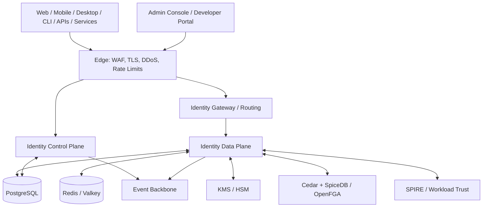

# Universal IAM Platform
## Best-in-Class Product, Architecture and Engineering Plan

**Document type:** Product strategy and technical architecture plan  
**Version:** 0.2  
**Status:** Working draft for architecture review  
**Date:** 1 November 2026

---

# 1. Executive vision

Build an open-source, enterprise-grade Identity and Access Management (IAM) platform that provides a unified identity foundation for:

- Consumer applications and Customer Identity and Access Management (CIAM).
- Workforce identity and enterprise SSO.
- SaaS and PaaS platforms.
- Web, SPA, mobile, desktop and CLI applications.
- APIs, microservices and machine-to-machine communication.
- Cloud infrastructure, Kubernetes workloads and on-premises systems.
- Automated agents and AI workloads.
- Multi-tenant software and identity-as-a-service deployments.

The product should combine the strengths of modern identity platforms while maintaining a clear architecture, strong standards compliance, high security, operational resilience, and a developer experience that makes integration straightforward.

The goal is not to implement the largest possible feature checklist. The goal is to build a coherent identity platform in which every feature has a defined security model, protocol contract, lifecycle, audit trail and operational story.

## 1.1 Product principles

1. **Security first:** Secure defaults, threat modelling, independent review and protocol conformance are release requirements.
2. **Standards first:** Prefer published standards over proprietary protocols and claims.
3. **Human and machine identity:** Both are first-class identity categories.
4. **Separation of concerns:** Authentication, federation, authorization, governance and provisioning are distinct capabilities.
5. **Control plane / data plane separation:** Administrative operations must not burden the latency-sensitive authentication path.
6. **Multi-tenancy by design:** Support shared identity, isolated realms and configurable tenant boundaries.
7. **Developer-owned experience:** Developers can use hosted UI, headless SDKs or their own fully custom interface.
8. **Extensible without compromising the core:** Extensions cannot bypass credential validation, policy enforcement or token security.
9. **Portable deployment:** Self-hosted, managed SaaS, private cloud and hybrid deployment models.
10. **Observable and auditable:** Every security-sensitive action has a traceable actor, subject, context and outcome.
11. **Secure interoperability:** Test against independent clients, identity providers and resource servers.
12. **No premature feature claims:** A capability is not production-ready until its failure modes, operational controls and conformance tests are implemented.

# 2. Product scope and market positioning

The platform should cover five related product domains.

| Domain | Primary users | Core value |
|---|---|---|
| Customer IAM (CIAM) | SaaS and consumer application developers | Registration, login, account security and customer identity |
| Workforce IAM | IT and security teams | Employee identity, enterprise SSO and directory integration |
| Identity federation | Enterprise application owners | OIDC, SAML, external IdPs and trust relationships |
| Machine/workload identity | Platform and infrastructure teams | Service identities, certificates and workload federation |
| Identity governance and administration (IGA) | Security and compliance teams | Lifecycle, access reviews, delegated administration and audit |

Authorization should be integrated through native capabilities and pluggable policy/relationship engines. The platform should not assume that authentication and authorization are the same subsystem.

# 3. Recommended technology strategy

## 3.1 Primary recommendation

Use a **Rust-first security and protocol core**, supported by mature specialist components where they offer materially stronger interoperability or operational capabilities.

Do not choose technologies merely because they are written in the same language. The best architecture is allowed to be polyglot, but every additional runtime must justify its operational cost.

## 3.2 Technology choices

| Area | Preferred technology | Role and rationale |
|---|---|---|
| Core security services | Rust | Memory safety, predictable resource use and high-performance network services |
| Async runtime | Tokio | Asynchronous execution and networking |
| HTTP framework | Axum | Typed routing and async service composition |
| Serialization | Serde | Structured data serialization |
| TLS | rustls | Modern TLS implementation |
| Database | PostgreSQL | Authoritative transactional identity store |
| Database access | SQLx | Async access and compile-time checked queries |
| Schema migrations | SQLx migrations or refinery | Versioned schema evolution |
| Cache | Redis or Valkey | Ephemeral state, rate limits and selected caches |
| Authorization policy | Cedar | Policy language and policy evaluation |
| Relationship authorization | SpiceDB or OpenFGA | Zanzibar-style relationship authorization |
| Workload identity | SPIFFE/SPIRE | Workload identity and attestation |
| Event backbone | Kafka for high-scale enterprise; NATS JetStream for lean deployments | Durable event distribution |
| Secrets | OpenBao plus cloud KMS/HSM | Secret lifecycle and cryptographic key protection |
| SAML interoperability | Evaluate OpenSAML-based federation adapter | Mature SAML interoperability; isolate it behind a protocol boundary |
| Admin and hosted UI | React + TypeScript | Rich application and theming ecosystem |
| UI primitives | Radix UI | Accessible composable components |
| Styling | Tailwind CSS + design tokens | Themeable design system |
| Mobile SDKs | Native Swift/Kotlin plus Flutter SDK | Native platform integration and cross-platform support |
| API contracts | OpenAPI 3.1 | API documentation and SDK generation |
| Internal RPC | gRPC where justified | Strongly typed service communication |
| API edge | Envoy or Kong | Routing, TLS, rate limiting and edge policy |
| Telemetry | OpenTelemetry | Vendor-neutral traces, metrics and logs |
| Metrics and dashboards | Prometheus + Grafana | Monitoring and operations |
| Log aggregation | Loki or OpenSearch | Operational log search |
| Deployment | OCI containers, Kubernetes and Helm | Portable enterprise deployment |
| Infrastructure provisioning | Terraform/OpenTofu | Reproducible infrastructure |
| Configuration management | Ansible | Host and service configuration |
| Testing | Rust test ecosystem, Testcontainers, Playwright, k6 | Unit, integration, browser and load testing |

### Technology selection caveats

- Rust is the preferred implementation language for security-sensitive services, not a reason to rewrite mature standards implementations without evidence.
- SAML should be implemented using a mature, independently tested library or isolated adapter. Do not invent XML signature or XML encryption handling.
- PostgreSQL remains the authoritative source of identity data. Redis is not the source of truth.
- Kafka and NATS are alternatives for different operating profiles. Do not require both in the default deployment.
- Kubernetes is a deployment option for scale, not a prerequisite for a small self-hosted installation.
- HSM/KMS is the preferred protection boundary for high-value signing keys in production.
- Select exact library versions only after a proof-of-concept, security review, license review and maintenance assessment.

# 4. Architectural model: Control plane and data plane

## 4.1 Control plane

The control plane manages configuration and lifecycle:

- Organizations, tenants and realms.
- Applications and OAuth clients.
- Identity providers and federation connections.
- Authentication methods and policies.
- User and machine identity administration.
- Roles, groups and authorization configuration.
- Branding and login experiences.
- SCIM provisioning configuration.
- Credential and signing-key lifecycle.
- Support access policies.
- Audit search and governance.
- System configuration and deployment operations.

The control plane may have a richer API and administrative UI. It should not be on the critical path for every token validation.

## 4.2 Data plane

The data plane handles latency-sensitive identity operations:

- Authentication transactions.
- Credential verification.
- MFA challenges.
- OIDC authorization.
- OAuth token issuance and exchange.
- SAML protocol transactions.
- Session validation and revocation checks.
- Token introspection.
- Client authentication.
- Workload identity exchange.
- Policy decision requests where required.

Data-plane instances should be horizontally scalable and as stateless as practical. Durable transaction state belongs in PostgreSQL or another explicitly selected state store; short-lived state may use a cache with well-defined failure semantics.

## 4.3 Logical architecture

This is a logical view, not a requirement to deploy every box as a separate microservice on day one.

# 5. Identity domain model

The data model must avoid conflating people, accounts, credentials, tenants, applications and memberships.

## 5.1 Core entities

| Entity | Definition |
|---|---|
| Realm | A security and identity boundary with issuer, policy and configuration |
| Tenant | A customer or administrative isolation boundary |
| Organization | A business entity inside a realm or tenant |
| Principal | A general security subject, human or non-human |
| Human identity | A person represented in the identity system |
| Machine identity | A service, workload, application or automation identity |
| Account | A login account or linked external identity |
| Credential | A password verifier, passkey, OTP secret, certificate or key |
| Profile | Human-readable identity attributes |
| Membership | Relationship between a principal and an organization |
| Group | Collection of principals |
| Application | A product or application registered with the platform |
| OAuth client | A protocol client registered with the authorization server |
| Resource server | An API or protected resource |
| Identity provider connection | External OIDC, SAML, LDAP or other trust connection |
| Session | Authenticated interaction state |
| Device | A registered or recognized device |
| Grant | Authorization previously given to a client |
| Workload | A running service or compute instance |
| Support access session | Time-bound delegated support context |

## 5.2 Identity design requirements

- Support one global human identity with multiple linked login accounts.
- Support multiple organization memberships with different roles and policies.
- Support realm-isolated identity where customers require hard separation.
- Support tenant-scoped identifiers and pairwise subject identifiers.
- Never use email address as the immutable primary identity key.
- Keep authentication credentials separate from profile attributes.
- Keep machine identities separate from human identities in policy and lifecycle logic.
- Define account linking and account merging with explicit proof-of-control requirements.
- Preserve immutable identifiers across profile changes.
- Define deletion, retention, anonymization and legal-hold behavior.

# 6. Authentication capabilities

## 6.1 Password-based authentication

- Email and password.
- Username and password.
- Phone and password where appropriate.
- Password reset and recovery.
- Password change.
- Compromised credential screening.
- Rate limiting and credential-stuffing protection.
- Account lockout and recovery.
- Password policy configuration.
- Secure password hashing using Argon2id with reviewed parameters.
- Rehash-on-login and algorithm migration.

Avoid arbitrary password expiration as a universal default. Allow organization policy to require rotation where justified by risk or regulation.

## 6.2 Passwordless authentication

- WebAuthn and passkeys.
- Platform authenticators.
- Roaming FIDO2 security keys.
- Magic links.
- Email-based login.
- Phone-based login.
- Recovery codes.
- Device-bound authentication where supported.

Passkeys should support discoverable credentials, user verification, credential lifecycle, backup eligibility/state handling where available, and account recovery controls.

## 6.3 OTP and MFA

- TOTP.
- HOTP where needed for interoperability.
- Email OTP.
- SMS OTP.
- Push approval.
- Recovery codes.
- WebAuthn security keys.
- Step-up authentication.
- MFA enrollment and recovery policies.
- Phishing-resistant MFA requirements for privileged users.

Email and SMS should not be represented as equivalent to phishing-resistant authenticators.

## 6.4 Social login

Provide a generic OIDC/OAuth provider framework and maintained provider integrations for major ecosystems such as Google, Microsoft, Apple, GitHub and GitLab.

Requirements:

- Provider-specific scopes.
- PKCE where applicable.
- State and nonce validation.
- Issuer validation.
- Account linking.
- Account unlinking.
- Provider token storage and revocation policy.
- Provider outage handling.
- Explicit identity collision resolution.

## 6.5 Enterprise and legacy authentication

- LDAP and Active Directory federation.
- Kerberos/SPNEGO where required.
- RADIUS integration where relevant.
- Client certificate authentication.
- Smart-card integration.
- External OIDC federation.
- SAML federation.
- Legacy protocol bridging only where justified.

# 7. OAuth 2.0 and OpenID Connect

The platform must be a standards-compliant authorization server and OpenID Provider.

## 7.1 Core flows

- Authorization Code with PKCE.
- Authorization Code for confidential clients, with PKCE support.
- Client Credentials.
- Device Authorization Grant.
- Refresh Token.
- Token Exchange.
- JWT Bearer assertion grant where required.
- Private Key JWT client authentication.
- Mutual TLS client authentication.

Do not implement Implicit Grant or Resource Owner Password Credentials as normal supported login flows. Follow current OAuth security best practices.

## 7.2 Protocol capabilities

- Authorization endpoint.
- Token endpoint.
- Revocation endpoint.
- Introspection endpoint.
- UserInfo endpoint.
- Discovery metadata.
- JWKS endpoint.
- Client registration.
- Authorization server metadata.
- PAR.
- JAR.
- JARM where supported.
- RAR.
- DPoP.
- mTLS-bound tokens.
- Token exchange.
- Logout and session-management specifications.

## 7.3 Token design

Support:

- JWT access tokens.
- Opaque access tokens.
- ID tokens.
- Refresh tokens.
- Authorization codes.
- Device codes.
- Client assertions.
- Logout tokens.
- Delegated token-exchange results.

Requirements:

- Strict issuer and audience validation.
- Explicit token type and intended use.
- Short-lived access tokens by default.
- Refresh-token rotation and replay detection.
- Signing-key rotation and key identifiers.
- JWKS publication and overlap during key rotation.
- Pairwise subject identifiers.
- Scope and authorization details.
- Sender-constrained tokens where appropriate.
- No access tokens in URL query strings.
- No sensitive data in JWT claims without a specific reason.

Resource servers should validate JWTs locally when appropriate. Opaque tokens and introspection remain available where central revocation or dynamic authorization is required.

# 8. SAML and enterprise federation

Implement both Identity Provider (IdP) and Service Provider (SP) capabilities.

## 8.1 SAML features

- SP-initiated SSO.
- IdP-initiated SSO with strict protections.
- Metadata publishing and importing.
- Assertion Consumer Service.
- Single Logout.
- Signed requests and responses.
- Signed assertions.
- Encrypted assertions.
- Certificate rollover.
- NameID formats.
- Attribute mapping.
- Multiple IdP connections.
- Replay protection.
- Destination, recipient, audience and time-condition validation.
- XML signature wrapping defenses.
- Secure XML parser configuration.
- Clock-skew controls.

SAML is a high-risk XML security area. Use mature implementations, security test suites and independent review. Do not create a bespoke XML signature stack.

## 8.2 Federation broker

The platform should support:

- OIDC-to-OIDC federation.
- SAML-to-OIDC federation.
- OIDC-to-SAML bridging.
- External enterprise identity providers.
- Domain discovery.
- Just-in-Time provisioning.
- Attribute transformation.
- IdP routing policies.
- Home-realm discovery.
- Identity linking with verified claims.
- Federation trust lifecycle and certificate rotation.

# 9. Machine identity and workload identity

Machine identity must be a first-class subsystem, not a human account with a different label.

## 9.1 Identity categories

- OAuth client.
- Service account.
- Service principal.
- Application identity.
- Workload identity.
- Kubernetes workload.
- Cloud workload.
- CI/CD runner.
- Robot/automation account.
- AI agent identity.

Define each product concept precisely. Terminology such as service account and service principal varies across ecosystems.

## 9.2 Authentication mechanisms

- Client Credentials.
- Private Key JWT.
- mTLS.
- X.509 certificates.
- JWT bearer assertions.
- SPIFFE/SPIRE workload identity.
- Kubernetes projected service-account tokens.
- AWS, Azure and Google Cloud workload federation.
- Token exchange from trusted external assertions.
- Short-lived certificate and token issuance.

## 9.3 Lifecycle and governance

- Identity registration.
- Attestation and trust policy.
- Public key registration.
- Certificate issuance and rotation.
- Credential expiry.
- Revocation.
- Audience restrictions.
- Scope restrictions.
- Environment restrictions.
- Workload inventory.
- Last-used tracking.
- Owner and business-purpose metadata.
- Machine identity risk and anomaly signals.

Never rely on long-lived shared secrets as the only machine authentication method.

# 10. Authorization architecture

Authentication and authorization must have independent models and APIs.

## 10.1 Authorization models

- RBAC.
- ABAC.
- ReBAC.
- ACL.
- Policy-based authorization.
- OAuth scopes.
- Resource-specific permissions.

## 10.2 Recommended architecture

Use a layered model:

1. Cedar for expressive policy decisions and contextual attributes.
2. SpiceDB or OpenFGA for relationship-based permissions.
3. OAuth scopes and resource indicators for API delegation.
4. Application-level enforcement for resource-specific business invariants.

Do not assume that an IAM-issued role claim is sufficient to authorize every operation. Resource servers must enforce authorization at the point where the resource and business context are known.

## 10.3 Authorization capabilities

- Organization roles.
- Application roles.
- Group membership.
- Resource relationships.
- Role inheritance.
- Conditional policies.
- Permission evaluation API.
- Policy versioning.
- Explain/decision traces for administrators.
- Policy testing.
- External engine adapters.
- Cache invalidation and consistency semantics.

# 11. Session and device management

- Browser sessions.
- Mobile sessions.
- Desktop sessions.
- Device registration.
- Concurrent session policy.
- Idle timeout.
- Absolute lifetime.
- Session rotation.
- Global logout.
- Per-device logout.
- Session revocation.
- Remembered devices.
- Session risk signals.
- Session activity history.
- Reauthentication for sensitive operations.
- Back-channel logout where supported.

Session identifiers must be unpredictable, securely stored and protected from fixation and replay. Browser session cookies should use appropriate Secure, HttpOnly and SameSite attributes.

# 12. Adaptive security and risk engine

Provide a policy-driven risk evaluation capability.

Signals may include:

- New device.
- Unusual IP or network.
- IP reputation.
- Login velocity.
- Credential stuffing indicators.
- Impossible travel.
- Abnormal session behavior.
- Authentication method strength.
- User and organization risk context.

Possible actions:

- Allow.
- Require MFA.
- Require phishing-resistant MFA.
- Reauthenticate.
- Restrict session.
- Require administrator approval.
- Deny and alert.

Signals must not be treated as proof of identity. Geolocation and device fingerprinting should be privacy-conscious, transparent and configurable.

# 13. Developer-customizable authentication experience

This is a core product differentiator.

## 13.1 Three integration modes

### Hosted UI

The identity platform hosts login, registration, recovery, consent and MFA experiences.

Capabilities:

- Custom domains.
- Themes and design tokens.
- Logo and typography.
- Layout selection.
- Custom text and localization.
- Configurable authentication methods.
- Custom email templates.
- Accessible components.
- Brand-specific error and recovery pages.
- Versioned theme configuration.

### Headless SDK

Developers own every screen and use SDKs for secure protocol and authentication orchestration.

Provide:

- React and TypeScript SDK.
- JavaScript browser SDK.
- Server-side SDKs.
- Flutter SDK.
- Native Swift and Kotlin SDKs.
- Java/Kotlin, Go, Python, .NET and Rust SDKs.

### Self-hosted UI

Allow customers to host the UI independently while using the identity server's protocol endpoints and supported APIs.

## 13.2 Customization architecture

- Theme configuration schema.
- Design tokens.
- Component slots.
- Replaceable page layouts.
- Localization bundles.
- Versioned themes.
- Theme preview and testing.
- Custom domain verification.
- CSP and security-header requirements.
- Theme rollback.
- Tenant-specific branding.

Do not execute arbitrary tenant JavaScript inside the identity server's trusted origin. Prefer developer-hosted components, isolated customization boundaries and a strict content-security model.

# 14. Supervised support access and delegated identity

Product name: **Supervised Support Access**.

Purpose: An authorized support operator can temporarily access a customer's application context under restricted, visible and auditable delegation.

This must not be a hidden password bypass or a mechanism that erases the real actor's identity.

## 14.1 Identity semantics

Preserve:

- Subject: the customer whose resources are being accessed.
- Actor: the support engineer performing the access.
- Client: the application through which access occurs.
- Tenant: the organization that owns the data.
- Support session: the approved delegation context.
- Purpose: ticket, case or documented reason.

Use OAuth Token Exchange concepts and the actor claim where appropriate. Distinguish delegation from impersonation.

## 14.2 Authorization formula

Effective support permissions must be no greater than:

`Target user permissions ∩ Support agent permissions ∩ Support policy permissions`

The platform must also apply resource-specific restrictions and deny sensitive operations independently.

## 14.3 Workflow

1. Support agent authenticates with strong MFA.
2. Agent selects tenant, target user and application.
3. Agent provides a support ticket and reason.
4. Policy evaluates agent eligibility, target consent, tenant settings and requested access.
5. Approval is obtained when required.
6. A support session is created with explicit scope, audience and expiry.
7. A short-lived delegated token is issued.
8. The application visibly indicates support mode.
9. Every request is logged with actor and subject.
10. Session expires or is revoked; all derived credentials are invalidated according to policy.

## 14.4 Security requirements

- No customer password or refresh token is exposed.
- No silent actor substitution.
- No privilege escalation above the target or support agent.
- Read-only is enforced at the resource/API layer, not only in UI.
- Sensitive fields can be masked or denied.
- No refresh token for support sessions.
- Short token lifetime and bounded support-session duration.
- Explicit revocation.
- Ticket/reason required.
- Tenant-level enablement and policy.
- Configurable customer or administrator consent.
- Visible support banner.
- Immutable audit events.
- Break-glass mode is separate, heavily controlled and independently reviewed.
- Support access cannot be initiated from another support session.

A read-only session can still expose highly sensitive information. Read access must be classified and governed.

# 15. Identity provisioning and lifecycle

## 15.1 SCIM

Support SCIM 2.0 as both a server and, where required, a client.

- Users.
- Groups.
- Group membership.
- Create, update and deactivate.
- Filtering and pagination.
- Attribute mapping.
- Bulk operations where supported.
- Provisioning logs.
- Idempotency and retry behavior.
- Authentication and authorization for provisioning endpoints.

## 15.2 Lifecycle

- Invitation.
- Registration.
- Verification.
- Joiner/mover/leaver workflows.
- Account linking.
- Account recovery.
- Suspension.
- Deprovisioning.
- Deletion and retention.
- Directory synchronization.
- Access revocation on termination.
- Legal hold and regulated retention.

# 16. Identity governance and administration

- Delegated administration.
- Access reviews.
- Access certification.
- Entitlement management.
- Privileged access workflows.
- Approval policies.
- Separation-of-duties rules.
- Identity risk reporting.
- Credential inventory.
- Service-account ownership.
- Dormant identity detection.
- Stale credential detection.
- Audit search and export.
- Compliance evidence.
- Administrative action history.

Keep governance capabilities modular so smaller deployments do not need to operate a full IGA subsystem.

# 17. Cryptographic architecture and key management

This is a critical security boundary.

- Asymmetric signing keys.
- Key identifiers and rotation.
- JWKS publication.
- Overlapping active verification keys during rotation.
- HSM/KMS-backed private keys for high-assurance deployments.
- Certificate issuance and revocation.
- TLS certificate lifecycle.
- Key usage separation.
- Tenant/realm key isolation where required.
- Encryption at rest.
- Envelope encryption for sensitive secrets.
- Secure backup and recovery of key material.
- Cryptographic agility and algorithm deprecation policy.

Private signing keys should not be stored as ordinary application configuration or committed to source control.

# 18. Data architecture

## 18.1 Authoritative storage

PostgreSQL is the primary source of truth for:

- Principals and identities.
- Accounts and credentials metadata.
- Organizations and tenants.
- Applications and OAuth clients.
- Federation configuration.
- Sessions and grants where durable storage is required.
- Authentication policies.
- Support access sessions.
- Provisioning state.
- Audit metadata.

## 18.2 Cache

Redis/Valkey may store:

- Rate-limit counters.
- Short-lived transaction state.
- Selected session caches.
- Non-authoritative metadata caches.
- Replay-detection state where the consistency model is explicit.

Define behavior for cache outage, eviction, failover and stale entries. Security-critical replay protection must not silently fail open.

## 18.3 Audit and event storage

- Transactional outbox for reliable event publication.
- Durable audit records.
- Append-only or tamper-evident audit strategy.
- Separate retention policies.
- Export to SIEM.
- Tenant-aware audit access.
- Correlation IDs and trace context.
- Actor, subject, client, tenant and outcome fields.

Audit events should not contain passwords, raw OTP values, private keys, bearer tokens or other secrets.

# 19. High availability, scalability and disaster recovery

## 19.1 Deployment topologies

- Single-node development.
- Single-region production across multiple availability zones.
- Multi-region active/passive.
- Multi-region active/active data plane with a carefully defined write and consistency model.
- Dedicated tenant deployment.
- Fully isolated regulated deployment.

## 19.2 Database strategy

Start with PostgreSQL HA using a supported managed service or a well-operated PostgreSQL cluster.

Possible self-managed components include Patroni, etcd/Consul and HAProxy/PgBouncer, subject to operational validation.

Use regional read replicas where suitable. Do not promise multi-region active-active writes without explicitly solving conflict handling, identity uniqueness, revocation propagation and transaction consistency.

## 19.3 Availability objectives

Define measurable targets before production:

- Availability SLO.
- Authentication latency percentiles.
- Token issuance latency percentiles.
- Maximum tolerated revocation propagation delay.
- Recovery Time Objective (RTO).
- Recovery Point Objective (RPO).
- Regional failover time.
- Key recovery procedure.
- Backup restore validation.

## 19.4 Stateless scaling

- Horizontally scale data-plane instances.
- Keep local caches bounded.
- Use distributed coordination only where necessary.
- Avoid sticky sessions as a correctness requirement.
- Make transaction state explicit.
- Load test database connection limits and signing throughput.

# 20. Security engineering and assurance

Security must be an ongoing engineering process, not a final checklist.

## 20.1 Required controls

- Threat modelling for each protocol and feature.
- Secure coding standards.
- Dependency and software composition analysis.
- Static analysis.
- Fuzz testing.
- Property-based testing.
- Protocol conformance suites.
- Penetration testing.
- Independent cryptographic review.
- Secure SDLC.
- Signed build artifacts.
- SBOM generation.
- Reproducible builds where practical.
- Vulnerability disclosure policy.
- Security response process.
- Key compromise and incident runbooks.

## 20.2 Abuse cases to test

- Credential stuffing.
- Brute force.
- Account enumeration.
- Password reset abuse.
- OAuth redirect URI manipulation.
- PKCE downgrade.
- Authorization code replay.
- Mix-up attacks.
- Token substitution.
- JWT algorithm confusion.
- Key rotation race conditions.
- SAML signature wrapping.
- SAML replay.
- Session fixation.
- Refresh-token replay.
- Cross-tenant access.
- Privilege escalation.
- Support-session misuse.
- SCIM deprovisioning failures.
- Workload identity spoofing.
- Cache outage and stale authorization state.

# 21. Developer ecosystem

Provide:

- Admin API.
- Runtime authentication APIs.
- OpenAPI definitions.
- CLI.
- Terraform provider.
- SDKs for major languages.
- React components and hooks.
- Flutter SDK.
- Native mobile SDKs.
- Spring Boot integration.
- Express/Fastify integration.
- FastAPI/Django integration.
- ASP.NET Core integration.
- Go middleware.
- Resource-server validation libraries.
- Webhook/event SDK.
- Local development server.
- Test tenant and sample applications.
- OAuth/OIDC debugger.
- Migration guides from Keycloak, Auth0 and other providers.

SDKs must not hide protocol behavior or weaken security defaults.

# 22. Administration and developer portals

## 22.1 Identity administration console

- Realm and tenant management.
- User and machine identity management.
- Organization and group management.
- Application and client registration.
- Credential management.
- Identity provider configuration.
- SSO configuration.
- Authentication policies.
- MFA policies.
- Session management.
- Support access management.
- Audit and security events.
- Provisioning and SCIM status.
- Key and certificate management.
- Governance and access reviews.

## 22.2 Developer portal

- Application creation.
- Client credentials.
- Redirect URI management.
- SDK installation guides.
- API documentation.
- Login UI builder.
- Theme editor and preview.
- Webhook configuration.
- Test users.
- Protocol debugging.
- Token inspection with secrets redacted.
- Integration examples.
- Environment management.

# 23. Performance and efficiency plan

Performance goals must be measured on representative hardware and realistic database/network configurations.

Measure:

- Login throughput.
- Password verification throughput.
- Passkey verification throughput.
- Token issuance throughput.
- JWT verification throughput.
- Introspection latency.
- Session lookup latency.
- Database query latency.
- Cache hit ratio.
- Memory per instance.
- CPU per authentication transaction.
- Tail latency under load.
- Behavior during dependency failure.

Optimization priorities:

1. Keep the data plane small and independently scalable.
2. Avoid synchronous calls to notification and analytics systems in login paths.
3. Use local JWKS caching in resource servers.
4. Use bounded caches and explicit invalidation.
5. Use efficient database indexes and query plans.
6. Apply connection pooling.
7. Use asynchronous event publication through an outbox.
8. Avoid unbounded queues and background tasks.
9. Use cryptographic operations with reviewed implementations.
10. Profile before introducing custom optimizations.

Do not set arbitrary performance claims before a reproducible benchmark suite exists.

# 24. Testing and conformance strategy

## 24.1 Test layers

- Unit tests.
- Property-based tests.
- Fuzz tests.
- Database integration tests.
- Distributed failure tests.
- Browser end-to-end tests.
- Mobile integration tests.
- Load and stress tests.
- Upgrade and migration tests.
- Backup/restore tests.
- Protocol interoperability tests.
- Security regression tests.

## 24.2 Independent interoperability

Test the platform against independent:

- OIDC relying parties.
- OAuth clients.
- SAML service providers.
- External OIDC identity providers.
- SCIM clients.
- LDAP directories.
- SPIFFE workloads.
- Resource-server middleware.

## 24.3 Release gates

A release must not be called production-ready merely because the happy path works. Each protocol feature requires negative tests, malformed-input tests, replay tests, expiry tests, key-rotation tests and interoperability evidence.

# 25. Implementation roadmap

The roadmap is capability-based. Phases may overlap after architecture foundations are stable, but dependencies must be respected.

## Phase 0 — Product and security foundations

- Product scope and terminology.
- Threat model.
- Identity domain model.
- Realm and tenant isolation model.
- Protocol support matrix.
- Data classification.
- Security architecture.
- Technology proof-of-concepts.
- Licensing and dependency review.
- Architecture decision records.

**Exit criteria:** Approved domain model, threat model, architecture decisions and test strategy.

## Phase 1 — Identity foundation

- Realm and tenant management.
- Human and machine principal model.
- Accounts and credentials.
- Organization membership.
- User lifecycle.
- Password authentication.
- Email verification and recovery.
- Session model.
- Audit event model.
- Initial administration API.

**Exit criteria:** Secure, testable identity core with clear tenant isolation.

## Phase 2 — OAuth 2.0 and OpenID Connect

- Authorization Code + PKCE.
- Confidential client authentication.
- Client Credentials.
- Discovery.
- JWKS.
- UserInfo.
- ID and access tokens.
- Refresh-token rotation.
- Revocation and introspection.
- Logout.
- Client management.
- OIDC interoperability suite.

**Exit criteria:** Independent clients can authenticate and consume tokens securely.

## Phase 3 — Developer experience and UI platform

- Hosted login.
- Theme system.
- Custom domains.
- Headless SDK.
- React SDK.
- JavaScript/TypeScript SDK.
- Mobile SDK foundations.
- Developer portal.
- CLI and local development.
- Integration documentation.

**Exit criteria:** An external developer can integrate a real application without modifying the IAM core.

## Phase 4 — Strong authentication

- TOTP.
- Recovery codes.
- WebAuthn/passkeys.
- Push authentication.
- Step-up authentication.
- Device management.
- Authentication policy engine.
- Risk signals.

**Exit criteria:** Strong authentication and recovery paths pass security testing.

## Phase 5 — Federation and enterprise SSO

- OIDC federation.
- SAML IdP.
- SAML SP.
- Federation broker.
- LDAP/Active Directory integration.
- Domain discovery.
- JIT provisioning.
- SCIM server.
- SCIM client where required.

**Exit criteria:** Interoperability with representative enterprise identity providers and directories.

## Phase 6 — Machine and workload identity

- Service accounts.
- Private Key JWT.
- mTLS.
- X.509 lifecycle.
- SPIFFE/SPIRE integration.
- Cloud workload federation.
- Token exchange.
- Machine identity inventory.
- Credential rotation and revocation.

**Exit criteria:** Secure service-to-service and workload authentication without relying on permanent shared secrets.

## Phase 7 — Authorization

- Native RBAC.
- Cedar policy integration.
- SpiceDB/OpenFGA integration.
- Policy testing.
- Decision explanations.
- Resource-server SDKs.
- Permission and relationship administration.

**Exit criteria:** Authorization decisions are independently enforceable and auditable.

## Phase 8 — Supervised support access

- Support access policy.
- Actor/subject token model.
- Approval workflow.
- Ticket and reason capture.
- Scoped delegated tokens.
- Resource-server enforcement.
- Visible support mode.
- Audit and revocation.
- Abuse-case testing.

**Exit criteria:** No hidden actor substitution, no privilege escalation and complete traceability.

## Phase 9 — Governance and enterprise operations

- Access reviews.
- Entitlement management.
- Delegated administration.
- Privileged workflows.
- SIEM integration.
- Compliance exports.
- Key management integrations.
- Multi-region deployment.
- Disaster recovery.
- Enterprise operational controls.

**Exit criteria:** Documented operational readiness, recovery tests and independent security assessment.

## Phase 10 — Ecosystem and certification

- SDK coverage.
- Terraform provider.
- Migration tools.
- Integration marketplace.
- Protocol certification preparation.
- External security audits.
- Public vulnerability disclosure.
- Release and support policy.

**Exit criteria:** Stable public product with published compatibility and security commitments.

# 26. Standards and reference material

The following specifications should form the protocol and security baseline. Confirm their current status and applicable errata during implementation.

## OAuth and OIDC

- OAuth 2.0 Security Best Current Practice — RFC 9700: https://www.rfc-editor.org/rfc/rfc9700
- OAuth 2.0 Token Exchange — RFC 8693: https://www.rfc-editor.org/rfc/rfc8693
- OAuth 2.0 Demonstrating Proof of Possession — RFC 9449: https://www.rfc-editor.org/rfc/rfc9449
- OAuth 2.0 Mutual TLS — RFC 8705: https://www.rfc-editor.org/rfc/rfc8705
- OAuth 2.0 Pushed Authorization Requests — RFC 9126: https://www.rfc-editor.org/rfc/rfc9126
- OAuth 2.0 Rich Authorization Requests — RFC 9396: https://www.rfc-editor.org/rfc/rfc9396
- OpenID Connect specifications: https://openid.net/developers/specs/

## Federation and provisioning

- SAML 2.0 specifications: https://www.oasis-open.org/standards/
- SCIM Protocol — RFC 7644: https://www.rfc-editor.org/rfc/rfc7644
- SCIM Schema — RFC 7643: https://www.rfc-editor.org/rfc/rfc7643

## Authentication and workload identity

- WebAuthn: https://www.w3.org/TR/webauthn-3/
- FIDO Alliance: https://fidoalliance.org/
- SPIFFE: https://spiffe.io/
- SPIRE: https://spiffe.io/docs/latest/spire-about/

## Architecture and implementation references

- Rust: https://www.rust-lang.org/
- Tokio: https://tokio.rs/
- Axum: https://github.com/tokio-rs/axum
- PostgreSQL: https://www.postgresql.org/docs/
- OpenTelemetry: https://opentelemetry.io/docs/
- Cedar: https://www.cedarpolicy.com/
- SpiceDB: https://authzed.com/spicedb
- OpenFGA: https://openfga.dev/
- OpenBao: https://openbao.org/

# 27. Architecture decisions still requiring explicit approval

These must become Architecture Decision Records (ADRs), not undocumented assumptions.

1. Shared global identity versus isolated identity realms.
2. Realm, tenant and organization boundaries.
3. Rust-only versus selected polyglot protocol adapters.
4. Exact OAuth/OIDC implementation library and conformance approach.
5. SAML implementation and XML security strategy.
6. Native policy engine versus external policy engine boundaries.
7. PostgreSQL HA topology and multi-region write model.
8. JWT versus opaque token defaults by client/resource type.
9. Session and revocation consistency guarantees.
10. Key custody model: software keys, KMS or HSM.
11. Event backbone: Kafka or NATS.
12. Hosted UI extension and theme security model.
13. Support access consent, approval and emergency-access policy.
14. Audit immutability, retention and data residency.
15. Open-source license and commercial edition boundaries.
16. Security certification and protocol certification targets.

# 28. Definition of success

The platform is successful when:

- Developers can integrate it using standards-based protocols and supported SDKs.
- Enterprises can federate their existing identity providers and directories.
- Human and machine identities have clear, secure lifecycle management.
- Authorization is enforceable independently by resource servers.
- Support access is delegated, restricted, visible and fully auditable.
- UI customization does not require modifying the identity engine.
- Deployments can scale horizontally and recover from defined failures.
- Security and interoperability are demonstrated through repeatable tests.
- Small deployments remain operationally reasonable.
- Enterprise deployments have documented HA, governance and security controls.

**Final principle:** Build a secure identity foundation first, then expand its capabilities through independently testable modules. The platform should earn trust through protocol correctness, security engineering and operational reliability—not through the number of features advertised.
