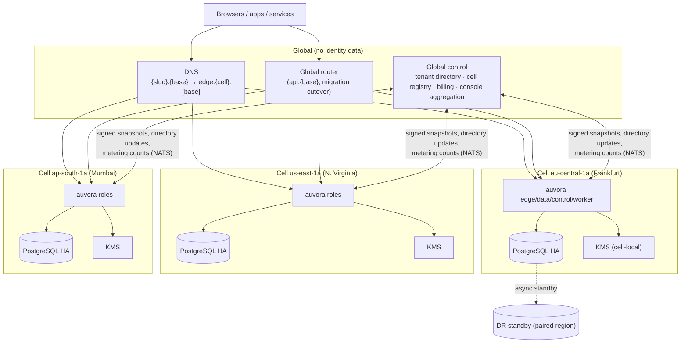
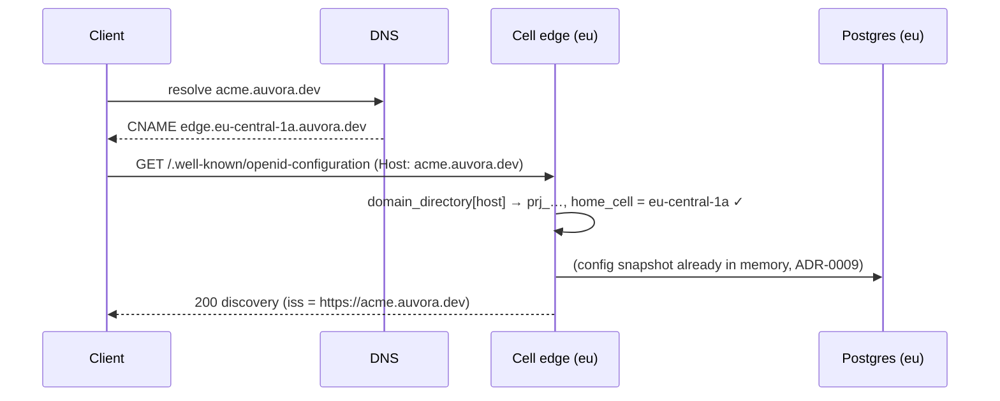

# Cells: cell-ready routing and placement design

- **Status:** Draft
- **Date:** 2026-11-01
- **Phase:** designed in P0, invariants enforced from P1, built in P9
- **Governing ADRs:**
  - [ADR-0019](../adr/0019-cell-architecture-multi-region.md) (authoritative)
  - [ADR-0009](../adr/0009-control-to-data-plane-config-propagation.md)
  - [ADR-0018](../adr/0018-identifier-format-uuidv7-prefixed.md)
  - [ADR-0026](../adr/0026-tenant-project-organization-hierarchy.md)
  - [ADR-0063](../adr/0063-auvora-cloud-operating-model.md)
  - [ADR-0090](../adr/0090-custom-domains-and-tls.md)
  - [ADR-0073](../adr/0073-state-stores-and-fail-modes.md)
  - [ADR-0033](../adr/0033-revocation-propagation-slo.md)
  - Also: [ADR-0008](../adr/0008-event-outbox-and-optional-bus.md), [ADR-0011](../adr/0011-key-custody-keyprovider.md), [ADR-0017](../adr/0017-tenancy-isolation-postgres-rls.md), [ADR-0055](../adr/0055-control-plane-admin-roles.md)
- **Plan:** [plan.md §5.3](../product/plan.md)

This spec defines how Auvora places projects into regional **cells** and routes traffic to them. Its most important part is §9: the invariants every P1+ change must respect, so that cells can be introduced in P9 **without a data migration or API change**.

Items marked **Decision (spec-level)** fill gaps the ADRs leave open. They can be changed by editing this spec. Contradicting an ADR requires a superseding ADR.

---

## 1. Terms

| Term | Definition |
|---|---|
| **Cell** | A complete Auvora deployment in one region across ≥ 3 AZs: all roles, its own PostgreSQL HA cluster, optional Valkey/NATS, its own KeyProvider config (ADR-0019 §1). Identified by `[cell] id` (e.g. `eu-central-1a`), with `[cell] region`. |
| **Home cell** | The cell that stores and serves all data of a project. Every project has exactly one (`projects.home_cell`). Every tenant has a default (`tenants.home_cell`). |
| **Global router** | A stateless forwarder that maps host / issuer / project ID → cell endpoint. It contains no auth logic. |
| **Global control** | Tenant directory, cell registry, billing, cross-cell admin aggregation. It holds no identity data and is not on the authentication path. |
| **Single-cell install** | Every self-hosted install by default, with `home_cell = 'default'`. The router and global control are disabled; global tables live locally (§4.3). |

## 2. Topology



## 3. Routing

### 3.1 Routing keys

| Inbound request | Routing key | Resolved by |
|---|---|---|
| `https://{slug}.{base}/…` (default issuer, Cloud) | host | **DNS**: `{slug}.{base}` CNAME → `edge.{cell}.{base}` |
| `https://{custom-domain}/…` | host | **DNS**: the customer CNAMEs to `{slug}.{base}` (ADR-0090 §2), so it follows the project's cell automatically |
| `https://{host}/p/{slug}/…` (path mode, self-hosted multi-cell) | host + first path segment | Global router |
| `https://api.{base}/v1/projects/{prj_…}/…` (global Admin API host) | project ID in the path | Global router, via the project directory |
| `https://api.{base}/v1/tenants/{ten_…}/…` | tenant ID | Global router → the tenant's home cell |
| Direct `edge.{cell}.{base}` | — | No routing. The cell's edge still maps host → project (ADR-0090 §5) |

**Decision (spec-level):** in Cloud, **DNS is the primary routing mechanism**, so the global router is not on the hot path for login and token traffic. The router is used only for the global API host, path-mode issuers, and as a fallback during migration cutover (§6). This satisfies ADR-0019 §4 ("stateless service or DNS-based routing").

### 3.2 Edge resolution inside a cell

Every request, even in a single-cell install, resolves the project through the `domain_directory` lookup (host → project; in path mode, host + slug → project). The edge then checks `project.home_cell == [cell] id`.

| Result | Response |
|---|---|
| Host unknown | `421 Misdirected Request` (ADR-0090 §5; no default-project fallback) |
| Project homed in this cell, state `active` | Serve |
| Project homed in another cell (stale DNS or router cache) | **Decision (spec-level):** reverse-proxy to the home cell for `[cell] forward_grace` (default 15 min after a migration), otherwise `421`. Never serve the request from local data. |
| Project state `frozen` (migration cutover) | Writes: `503` + `Retry-After: 5`. Reads that need no write (JWKS, discovery, static UI) are served. |
| Project state `moved` | Proxy to the new home cell during `forward_grace`, then `421` |

### 3.3 Router behaviour

| Aspect | Rule |
|---|---|
| State | An in-memory replica of `project_directory` + `domain_directory` + `cell_registry`, pulled from global control |
| Freshness | Push via NATS `auvora.global.directory.*`, plus a pull every 60 s (ADR-0019 §4 TTL) |
| Global control unreachable | Keep serving the last-known directory indefinitely (stale-while-error). Only *new* projects/domains are affected. Logins continue (ADR-0019 §5). |
| Unknown key | `421` (hosts) / `404` (IDs; ADR-0018 §4: no oracle) |
| Target cell unreachable | `503`. The router never fails over on its own; DR failover is a directory change (§8). |
| Security | No TLS termination of customer custom domains (SNI passthrough or redirect). The router holds no keys, no tokens, no auth logic. |
| Config | `[router] directory_url`, `[router] refresh_interval = "60s"` |



## 4. Global versus cell-local data

### 4.1 The rule

Everything identity-related belongs to exactly one project (ADR-0026 §4) and lives **only in the project's home cell**. Only the items below are global (ADR-0019 §3).

### 4.2 Global tables (closed list)

| Table | Columns (minimum) | Why it's global | Contains PII? |
|---|---|---|---|
| `cell_registry` | `cell_id`, `region`, `edge_endpoint`, `api_endpoint`, `snapshot_verify_keys`, `system_issuer`, `status` | Routing, trust between cells | No |
| `tenant_directory` | `tenant_id`, `slug`, `home_cell`, `status`, `plan`, `created_at` | Routing by tenant; billing | No (names and contacts stay in the home cell; see §4.4) |
| `project_directory` | `project_id`, `tenant_id`, `slug`, `home_cell`, `state` (`active`, `frozen`, `moving`, `moved`), `env_group_id`, `directory_version` | Routing by project ID and slug; global slug uniqueness | No |
| `domain_directory` | `hostname`, `project_id`, `kind` (`default`, `custom`, `org`), `verified_at` | Global hostname uniqueness; host routing | No |
| `usage_counters` | `tenant_id`, `project_id`, `period`, `metric`, `value` | Billing (ADR-0063 §6) | No (counts only) |
| `console_snapshots` | `project_id`, `kind`, `version`, `signed_snapshot` | Cross-cell console views, metadata only (ADR-0019 §3) | No (PII-tag checked; §7) |

Uniqueness that is global by definition is enforced **only** here: `tenant_directory.slug`, `project_directory.slug`, `domain_directory.hostname`.

### 4.3 Physical placement by phase

| Install type | Where the global tables live |
|---|---|
| Single cell (P1+) | PostgreSQL schema `auvora_global` in the cell's own database, accessed **only** through the `GlobalDirectory` trait (`auvora-store::global`) |
| Multi-cell (P9) | The global control service's database. Each cell keeps a read-only replica of the directory tables; writes go through the global control API |

The `GlobalDirectory` trait has one implementation (local schema) until P9, when a second (remote) implementation is added. That is the whole migration path.

### 4.4 Tenant-level and admin data

| Data | Location |
|---|---|
| Tenant name, billing contacts, invoices | Tenant's home cell (the billing service reads them via API) |
| Tenant audit (ADR-0026 §5) | Tenant's home cell |
| Admin principals (ADR-0055) | `prj_system` of the **tenant's home cell**. **Decision (spec-level):** each cell has its own system project. Other cells trust the home cell's system issuer through `cell_registry.system_issuer`, so admins authenticate once in the home cell and receive audience-restricted tokens for other cells' control APIs. |
| Admin role assignments on a project | In the project's cell, referencing the admin principal **by ID without a foreign key** (§9 I-4) |

## 5. Project placement

| Rule | Detail |
|---|---|
| Choice | `home_cell` is chosen at project creation, defaulting to `tenants.home_cell` (ADR-0019 §2) |
| Immutability | Changeable only by the migration tool (§6). The API rejects updates to `home_cell`. |
| Environment groups | **Decision (spec-level):** all projects in one `env_group_id` must share a home cell, so promotion (ADR-0070) stays a local operation. Migrating one project of a group migrates the whole group. |
| Dedicated cells | Enterprise/dedicated tiers (ADR-0063 §5) are cells with a single tenant in `cell_registry`. The routing model is the same. |

## 6. Cell migration (P9)

**Goal:** move a project (or environment group) to another cell with a write freeze of **≤ 60 s** (ADR-0019 §2), without changing `iss`, IDs, `sub` values or key IDs.

```mermaid
stateDiagram-v2
    [*] --> active
    active --> moving: migrate requested (dual control)
    moving --> moving: bulk copy + logical-replication catch-up
    moving --> frozen: lag < 2 s
    frozen --> moving: verification failed (abort; unfreeze)
    frozen --> active_new: verified, directory + DNS flipped
    active_new --> [*]: source purged (after retention)
    note right of frozen: ≤ 60 s budget, writes 503
```



| Step | Action | Writes allowed |
|---|---|---|
| 1. Prepare | Check the destination cell's capacity and version (both cells on the same Auvora version). Create the destination key material (§6.1). Mark `project_directory.state = moving`. | Yes |
| 2. Bulk copy | A PostgreSQL logical-replication publication with a row filter `WHERE project_id = $p` on every project-scoped table (PG 15+ row filters; PG 16 is the minimum, ADR-0044). Large partitions (audit, events) are copied by partition. | Yes |
| 3. Catch-up | Stream changes until replication lag < 2 s | Yes |
| 4. Freeze | Set `state = frozen` and broadcast via NOTIFY plus the directory push. Wait for in-flight transactions to drain (≤ 5 s). | **No** (`503`) |
| 5. Final sync and verify | Drain the remaining WAL. Compare per-table row counts and the audit hash-chain head (ADR-0039). Compare `project_config_version`. | No |
| 6. Cut over | Set `home_cell = new`, `state = active` in the directory; update the DNS CNAME (TTL 60 s); push to routers. The source sets `moved` and starts forwarding (§3.2). | Yes (in the new cell) |
| 7. Drain | Stop and move remaining outbox rows and scheduled jobs (`project_id`-keyed). Recompute ACME/TLS certificates in the new cell (or copy the encrypted certs). | Yes |
| 8. Purge | After `[migration] source_retention` (default 7 days, for rollback), crypto-shred the project DEKs and delete rows in the source cell. Emit a residency attestation audit event. | — |

**Freeze-window impact:** new logins, refreshes and session writes return `503` for ≤ 60 s. Locally validated JWTs, JWKS and discovery keep working. SDKs retry on `503` with `Retry-After`.

**Rollback:** before step 6, abort means unfreeze the source. After step 6, a reverse migration runs while the source retention is still intact.

### 6.1 Keys during migration

| Provider | Procedure |
|---|---|
| `local` (ADR-0011) | **Decision (spec-level):** the project KEK is re-wrapped from the source cell's root KEK to the destination's through an ephemeral ECDH (P-256) transfer key negotiated between the two cells' control roles. Plaintext key material never touches disk or the network. DEKs and signing keys stay wrapped by the project KEK, so they need no re-wrap. |
| Cloud KMS | Multi-region KMS keys (replica in the destination region) are preferred. Otherwise, create a new project KEK in the destination KMS and re-wrap the DEKs during step 2. Signing keys that are non-exportable can't move: publish a new key in the destination, keep the old `kid` in JWKS in `retiring` state (verify-only), and serve verification of the old `kid` via its public key. |
| HSM (PKCS#11) | Same as non-exportable KMS: rotate on migration, keep the old public key in JWKS until its tokens expire. |

Key IDs (`kid`) are never rewritten. JWKS in the new cell includes all keys that are still verifying.

## 7. Cross-cell configuration snapshots

Used for global console views and cross-cell config (ADR-0009 §6), delivered over NATS (ADR-0008) with a ≤ 30 s cross-cell SLO (ADR-0033).

**Decision (spec-level): format.** A JWS in compact serialization:

| Field | Value |
|---|---|
| Header | `{"alg":"EdDSA","typ":"auvora-config-snapshot+jws","kid":"<platform snapshot key id>"}` (`config_snapshot_signing` key class, ADR-0082) |
| Payload | JSON canonicalized with JCS (RFC 8785): `{ "snapshot_id", "source_cell", "target": "<cell_id or *>", "project_id", "kind", "version", "issued_at", "expires_at", "body" }` |
| `body` | Metadata only. Each field must carry the schema tag `pii=none` (ADR-0072); serialization rejects tagged PII at build time. |

Receivers verify, in order:
1. The signature, against `cell_registry.snapshot_verify_keys`.
2. That `target` matches this cell.
3. That `version` is greater than the stored version (monotonic; replays are ignored).
4. That `expires_at` is in the future.

Failures are logged and alerted, and the last good snapshot is kept (ADR-0009 §7).

## 8. Data residency and disaster recovery

### 8.1 What may leave a cell (exhaustive; ADR-0019 §3)

| Data | Channel |
|---|---|
| Directory entries (§4.2) | Global control API |
| Aggregated non-PII metrics | OTel / metrics pipeline |
| Billing usage counters | Outbox → NATS → global control |
| Signed console snapshots (metadata) | §7 |
| Migration streams | §6, only to the destination cell, initiated with dual control |
| DR replication | §8.2, only to the paired region of the same jurisdiction |

Customer-configured egress (webhooks, SIEM, SCIM client) is customer-directed and isn't covered by this guarantee. ADR-0103 governs it.

**Decision (spec-level):** a DR paired region must be in the same residency jurisdiction as the cell (Frankfurt ↔ an EU region; Mumbai ↔ another Indian region). If no such region exists, the cell's residency promise names the DR region explicitly.

### 8.2 Disaster recovery per cell

| Aspect | Target / mechanism |
|---|---|
| In-region availability | ≥ 3 AZs; Postgres HA with synchronous standby in another AZ |
| Cross-region | Async standby cell in the paired region (streaming replication) |
| RPO / RTO | ≤ 1 min / ≤ 1 h (ADR-0019 §6, ADR-0105) |
| Keys | Available in DR through multi-region KMS keys or a wrapped root-key backup (ADR-0019 §6) |
| Failover | Runbook (operator-initiated or automated): promote the standby, then update `cell_registry.edge_endpoint` and the DNS for `edge.{cell}.{base}`. `iss` and IDs are unchanged (ADR-0019 §7). |
| After failover | Replay caches start empty and the `state_epoch` increments (ADR-0073 rule 1), so in-flight codes, PAR request URIs and flows are invalidated (fail closed) |
| Verification | P9 exit drill within RPO/RTO; chaos tests for cell isolation, router outage and global-control outage during logins |

## 9. Invariants required from P1 (cell readiness)

These hold from the first P1 commit. Each one names how it is enforced, so that P9 adds services but changes no schema or API.

| # | Invariant | Enforcement |
|---|---|---|
| I-1 | **IDs:** UUIDv7 with a CSPRNG, no cell or region bits, globally unique without coordination (ADR-0018 §1, §6) | `auvora-core::id`; `serial`/`identity` columns are forbidden (lint in `scripts/`). The only sequences allowed are per-project counters that move with the project (e.g. `project_config_version`, audit chain position). |
| I-2 | **Every project-scoped table** has `tenant_id` and `project_id` columns, with indexes leading on `project_id` (ADR-0017) | Schema lint and RLS policy presence test |
| I-3 | **No foreign key crosses a project boundary.** Project tables may reference only rows of the same project. | Schema lint: every FK on a project-scoped table includes `project_id` in its column list (composite FKs) |
| I-4 | **Cross-project and cross-tenant references are by ID only** (no FK, no SQL join). Examples: admin principals in `prj_system`, environment links, federation between projects. They are resolved through tokens or APIs. | Code review; SQL lint rejects joins between project tables of different `project_id` |
| I-5 | **All global data** goes through `GlobalDirectory` (`auvora-store::global`) and lives in schema `auvora_global`. Global tables are exactly §4.2. | Schema lint: `auvora_global` tables must be in the §4.2 list; the runtime role has no direct grants on `auvora_global` outside `GlobalDirectory` |
| I-6 | **No database transaction spans `auvora_global` and project data.** Directory changes are made through the outbox (eventual) or the `GlobalDirectory` API (separate transaction with compensation). | `TenantTx` can't open global tables (type-level); integration test |
| I-7 | **Globally unique names** (tenant slug, project slug, hostnames) are enforced only in `auvora_global` | Schema lint: no `UNIQUE` constraint on `slug` or `hostname` in project tables |
| I-8 | **Routing indirection:** every request resolves `host` (+ path slug) → project through `domain_directory`, and checks `home_cell == [cell] id`, even in single-cell installs | Edge middleware; test that an unknown host returns `421` |
| I-9 | **`iss` never contains a cell or region identifier** (ADR-0019 §7) | Config validation at startup |
| I-10 | **`home_cell`** exists on `tenants` and `projects` (value `'default'` in single-cell installs) and `[cell] id` defaults to `default` (ADR-0019 implementation notes) | P1 migration; the API exposes it read-only |
| I-11 | **Keys are per project and wrapped by the project KEK** (ADR-0011 §4). Nothing project-specific is wrapped directly by the cell root KEK. | `auvora-crypto` API shape |
| I-12 | **Background work is project-keyed:** outbox rows, jobs, retries and ACME state carry `project_id`, so they can be drained and moved | Schema lint (I-2 covers the tables); job API requires `project_id` |
| I-13 | **No PII in cross-cell payloads:** every column has a `pii` tag (ADR-0072), and snapshot or event serializers for cross-cell channels reject tagged PII | Build-time serializer check + residency test (ADR-0019 verification) |
| I-14 | **Config snapshots are versioned per project** (`project_config_version`, monotonic) and the snapshot payload is serializable without in-process pointers, so §7 can ship it later | `auvora-config` round-trip test (serialize → deserialize → identical compiled snapshot) |
| I-15 | **Project-scoped caches and NATS subjects** include the project ID (and the cell ID for subjects: `auvora.<cell>.<project>.<event>`, ADR-0008) | Key-builder helpers are the only way to build keys |

## 10. Configuration

```toml
[cell]
id = "default"               # e.g. "eu-central-1a" in multi-cell
region = "local"
forward_grace = "15m"        # proxy window for stale routing after migration (§3.2)

[router]                     # only for the router role / multi-cell
directory_url = "https://global.internal.auvora.dev/v1/directory"
refresh_interval = "60s"

[migration]
source_retention = "7d"
max_freeze = "60s"
```

## 11. Open items handed to later phases

| Item | Phase |
|---|---|
| Global control service API and its own HA design | P9 |
| Path-mode multi-cell router for self-hosted EE | P9 |
| Cross-cell admin console UX (aggregated views from §7 snapshots) | P9 |
| Implementing the I-1…I-15 lints in `scripts/` and `auvora-store` tests | P0–P1 (with `auvora-store`, STATUS deliverable 14) |
