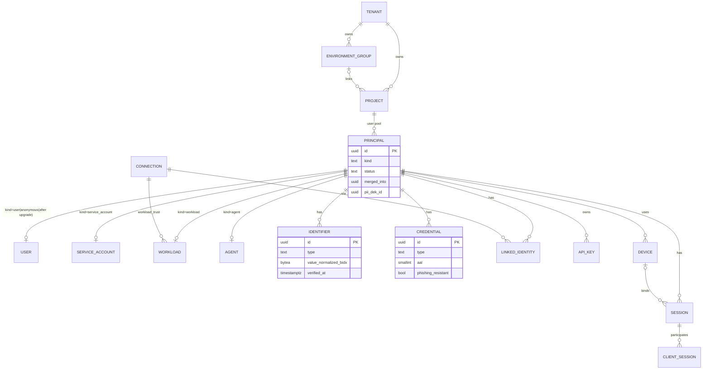
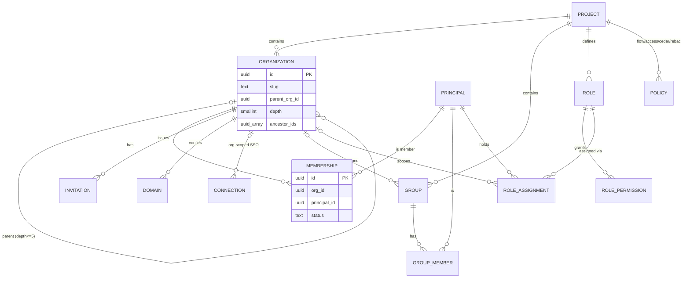
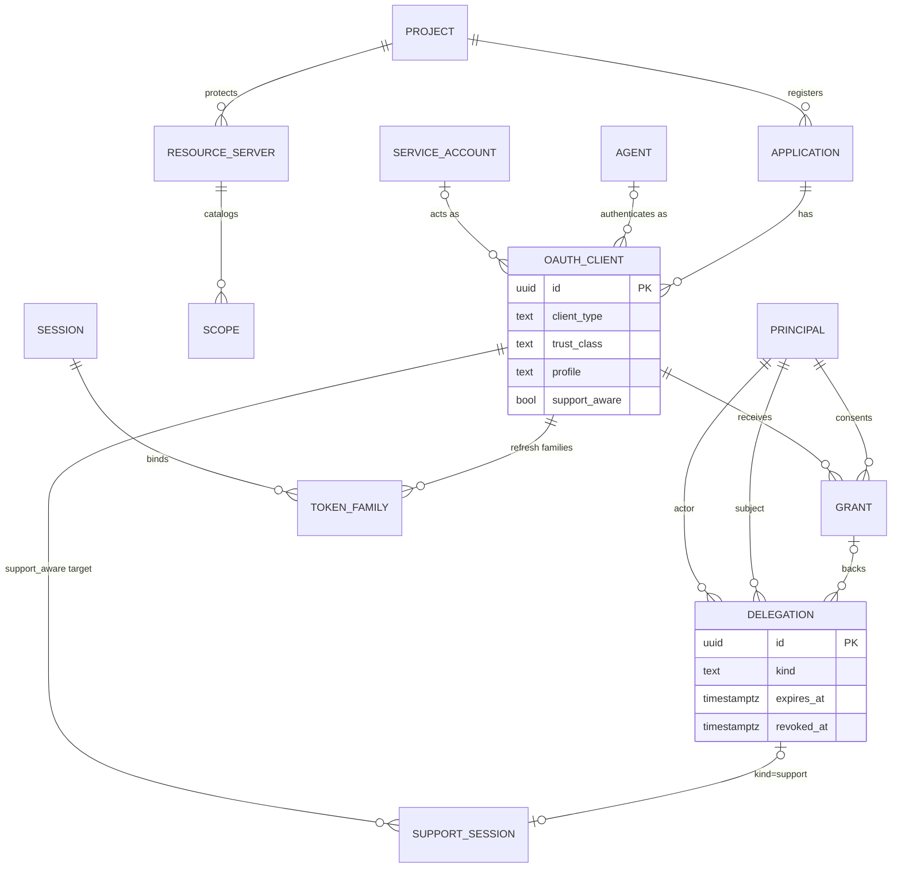
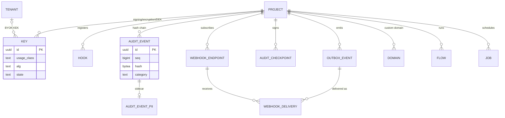

# Domain model

- **Status:** Draft
- **Date:** 2026-11-01
- **Governing ADRs:**
  - Hierarchy and scope: ADR-0017, ADR-0018, ADR-0026, ADR-0027.
  - Principals and identifiers: ADR-0034, ADR-0054, ADR-0071, ADR-0072, ADR-0075, ADR-0076, ADR-0077, ADR-0088.
  - Sessions, keys and delegation: ADR-0032, ADR-0053, ADR-0082, ADR-0086, ADR-0091, ADR-0092, ADR-0093, ADR-0094.
  - Events and audit: ADR-0039, ADR-0080, ADR-0109.
- **Plan refs:** plan.md §7
- **Companion spec:** [`tenancy-rls.md`](tenancy-rls.md) (how isolation of these tables is enforced)

This spec is the canonical list of persistent entities, their key fields, invariants and lifecycles. Column lists show **key fields only**. Migrations may add operational columns (`updated_at`, counters) without amending this spec. Adding an entity, changing a uniqueness scope or changing a lifecycle requires amending this spec. If it also contradicts an ADR, a superseding ADR is required.

---

## 1. Conventions (normative)

| Rule | Value |
|---|---|
| Schema | All tables live in schema `auvora`. Tables owned by the `ee` feature live in schema `auvora_ee`. |
| Table names | `snake_case`, **plural** (`principals`, `oauth_clients`). Join tables: `<a>_<b>` (`group_members`). |
| Primary key | `id uuid` holding a **UUIDv7** (ADR-0018). Generated in the application via `auvora_core::id::Id::generate`, never by the DB. |
| External ID | `<prefix>_<base32(id)>` per §2. It is **never stored**; it's derived on read from `(kind, id)`. |
| Tenancy columns | Every tenant-owned table has `tenant_id uuid NOT NULL`. Every project-owned table also has `project_id uuid NOT NULL`. Indexes and unique constraints **lead with `project_id`** (or `tenant_id` for tenant-level tables). See [`tenancy-rls.md`](tenancy-rls.md). |
| Foreign keys | Within a project, FKs are composite `(project_id, x_id)` → `(project_id, id)`, so a cross-project reference is impossible at the schema level. *Decision (spec-level).* |
| Timestamps | `timestamptz`, UTC. `created_at NOT NULL`. Soft-deletable entities have `deleted_at timestamptz NULL`. |
| Status columns | `text` with a `CHECK (status IN (…))` constraint; no Postgres enum types, because enums are hard to evolve under expand/contract (ADR-0025). *Decision (spec-level).* |
| Versioning | Mutable entities carry `version bigint NOT NULL` (optimistic concurrency → API `ETag`, ADR-0020/0071). |
| History | Each history-covered table `X` has `X_history` (ADR-0071 §2), written by repository code in the same transaction. Marked **H** in §3. |
| PII tags | Every column carries `COMMENT ON COLUMN … IS 'pii=<none\|direct\|indirect\|sensitive>;export=<true\|false>'` (ADR-0072). A schema lint fails migrations with untagged columns. Below, PII columns are marked `[d]` direct, `[i]` indirect, `[s]` sensitive. |
| Secrets | Verifier-only secrets are stored as `*_hash bytea`. Reversible secrets as `*_ciphertext bytea` (envelope-encrypted, AAD = `table:column:row_id:project_id`). Never plaintext (ADR-0072). |
| JSON | `jsonb` only for schema-validated documents (profile, policies) or bounded blobs (metadata ≤ 8 KB, ADR-0076). |
| Partitioned tables | Time range partitions per ADR-0109. They are marked **P** in §3. |

---

## 2. ID prefix registry

The prefixes are mirrored exactly from ADR-0018 and `crates/auvora-core/src/id.rs`. Code is authoritative if the two diverge. Fix the spec.

| Prefix | Entity | Table | Prefix | Entity | Table |
|---|---|---|---|---|---|
| `ten` | Tenant | `tenants` | `rs` | Resource server | `resource_servers` |
| `prj` | Project | `projects` | `con` | Connection | `connections` |
| `org` | Organization | `organizations` | `ses` | Session | `sessions_active` / `sessions` |
| `mem` | Membership | `memberships` | `dev` | Device | `devices` |
| `usr` | User | `principals` + `users` | `gnt` | Grant | `grants` |
| `sa` | Service account | `principals` + `service_accounts` | `dlg` | Delegation | `delegations` |
| `wl` | Workload | `principals` + `workloads` | `sup` | Support session | `support_sessions` |
| `agt` | Agent | `principals` + `agents` | `hook` | Hook | `hooks` |
| `anon` | Anonymous user | `principals` | `pol` | Policy | `policies` |
| `idn` | Identifier | `identifiers` | `key` | Key | `keys` / `platform_keys` |
| `cred` | Credential | `credentials` | `flw` | Flow | `flows` |
| `lid` | Linked identity | `linked_identities` | `evt` | Event | `audit_events` / `outbox_events` |
| `grp` | Group | `groups` | `inv` | Invitation | `invitations` |
| `rol` | Role | `roles` | `dom` | Domain | `domains` |
| `app` | Application | `applications` | `whk` | Webhook endpoint | `webhook_endpoints` |
| `cli` | OAuth client | `oauth_clients` | `job` | Background job | `jobs` |
| `ak` | API key | `api_keys` | `env` | Environment group | `environment_groups` |

Entities **without** a prefix aren't addressable by external ID. They are addressed through their parent: permissions (string names), scopes `(resource_server, name)`, role assignments, group members, client sessions, key versions and history rows.

---

## 3. Entities

Format for each entity: purpose · key fields · invariants · lifecycle · owner crate · ADRs.

### 3.1 Tenancy

#### Tenant (`ten`, `tenants`)
- **Purpose:** an Auvora customer account. It owns billing, platform admins, home cell and projects (ADR-0026).
- **Fields:** `id uuid`, `slug text`, `name text`, `home_cell text`, `isolation_tier text CHECK IN ('shared','dedicated-database','dedicated-deployment')`, `status`, `legal_hold bool`, `created_at`, `deleted_at`.
- **Invariants:** `slug` is unique per installation. Single-tenant installs have exactly one tenant (`[tenancy] multi_tenant = false`).
- **Lifecycle:** `active → suspended → deleted (30-day soft delete) → purged` (ADR-0054 §7).
- **Crate:** `auvora-store`.
- **Tenancy:** tenant-level table: `tenant_id` = `id`, RLS on `auvora.tenant_id`.

#### Environment group (`env`, `environment_groups`)
- **Purpose:** links projects that are environments of the same product (ADR-0026 §2, ADR-0070).
- **Fields:** `id`, `tenant_id`, `name`.
- **Invariants:** member projects belong to the same tenant. At most one project per `stage` value, except `custom`.
- **Crate:** `auvora-config`.

#### Project (`prj`, `projects`), **H**
- **Purpose:** exactly one issuer, user pool, key set and configuration. It is the unit of isolation (ADR-0026 §1).
- **Fields:**
  - `id`, `tenant_id`, `slug text`, `name`
  - `env_group_id uuid NULL`, `stage text CHECK IN ('development','staging','production','custom')`
  - `issuer text`, `issuer_locked_at timestamptz NULL`
  - `home_cell text`, `config_version bigint` (ADR-0009)
  - `settings jsonb`, `status`, `legal_hold`, `created_at`, `deleted_at`
- **Invariants:**
  - `slug` is unique per tenant.
  - `issuer` is unique per installation.
  - `issuer` is immutable once `issuer_locked_at` is set (first token issued), except via issuer migration (ADR-0026 §3).
  - `home_cell` is immutable except via the cell migration tool (ADR-0019).
- **Lifecycle:** as Tenant. Purge destroys the project KEK/DEKs.
- **Reserved:** one `prj_system` project per installation/cell holds control-plane admins (ADR-0055).
- **Crate:** `auvora-store`.
- **Tenancy:** project-level row; `project_id` = `id`.

### 3.2 Principals

Principals use a supertype table plus per-kind extension tables. *Decision (spec-level).* One `principals` table means one FK target for memberships, sessions, grants and audit, while kind-specific columns stay typed.

#### Principal (`principals`), **H**
- **Purpose:** any security subject (plan §7.2).
- **Fields:**
  - `id`, `tenant_id`, `project_id`
  - `kind text CHECK IN ('user','service_account','workload','agent','anonymous')`
  - `status text CHECK IN ('active','suspended','deleted')`
  - `legal_hold bool`, `merged_into uuid NULL`
  - `pii_dek_id uuid NULL` (per-principal DEK, ADR-0072)
  - `created_at`, `last_seen_at [i]`, `deleted_at`
- **Invariants:**
  - The external ID prefix derives from `kind`.
  - `kind` changes **only** `anonymous → user` (ADR-0077 §5).
  - `merged_into` is set only by a merge (ADR-0034 §5) and points to a principal in the same project.
- **Lifecycle:** `active ⇄ suspended → deleted → purged`. On purge, the row moves to `tombstones` (ADR-0054 §3).
- **Crate:** `auvora-store`.

#### User (`usr`, `users`, 1:1 with `principals`)
- **Fields:**
  - `principal_id` (PK = FK)
  - `profile jsonb [d/s per schema]`, `profile_schema_version int`
  - `public_metadata jsonb`, `private_metadata jsonb`, `unsafe_metadata jsonb` (each ≤ 8 KB, ADR-0076)
  - `ial smallint`, `password_changed_at`, `mfa_enrolled bool`
  - `terms_accepted jsonb` (version references, ADR-0079)
- **Invariants:**
  - `profile` validates against the project's profile schema version.
  - Sensitive profile attributes are encrypted under `pii_dek_id`.
- **Crate:** `auvora-authn`.

#### Service account (`sa`, `service_accounts`)
- **Fields:** `principal_id`, `name`, `description`, `owner_principal_id NOT NULL`, `purpose text NOT NULL`, `environment_tags text[]`, `last_used_at`.
- **Invariants:** an owner is required (ADR-0092 §6) and must be in the same project. There's no interactive login.
- **Crate:** `auvora-workload`.

#### Workload (`wl`, `workloads`)
- **Fields:** `principal_id`, `name`, `trust_connection_id uuid` (→ connection of kind `workload_trust`), `mapping_template text NULL`, `owner_principal_id`, `purpose`, `last_used_at`.
- **Invariants:** it never has stored secrets. Authentication is by federation only (ADR-0092 §1–2).
- **Crate:** `auvora-workload`.

#### Agent (`agt`, `agents`)
- **Fields:**
  - `principal_id`, `owner_principal_id NOT NULL`, `owner_kind text CHECK IN ('user','org','service_account')`
  - `publisher text`, `publisher_verified bool`, `version text`
  - `declared_capabilities text[]`, `allowed_resources text[]`
  - `risk_tier text CHECK IN ('low','medium','high')`, `max_delegation_depth smallint`
  - `attestation jsonb NULL`
- **Invariants:**
  - `max_delegation_depth` ≤ the project's `oauth.token_exchange.max_act_depth` (ADR-0086).
  - Each linked OAuth client links to exactly one agent (ADR-0091 §1).
- **Crate:** `auvora-agents`.

#### Anonymous user (`anon`, `principals` with `kind='anonymous'`)
- **Fields:** none beyond `principals`. A `users` row is created on upgrade.
- **Invariants:**
  - It has no identifiers and no credentials except a session-bound device key.
  - It can't hold admin roles, delegations or support-session targeting (ADR-0077 §4).
- **Lifecycle:**
  - Purged after `anonymous.ttl_days` of inactivity.
  - Merge leads to an immediate hard delete (no 30-day window).
- **`sub` stability (ADR-0114 R2):** The OIDC `sub` of `user` and `anonymous` principals is always rendered with the `usr_` prefix, so the upgrade `anonymous → user` doesn't change `sub` (ADR-0018 §5). The admin API still shows `anon_…` while the principal is anonymous.

### 3.3 Identifiers, credentials, linked identities

#### Identifier (`idn`, `identifiers`), **H**
- **Fields:**
  - `id`, `tenant_id`, `project_id`, `principal_id`
  - `type text CHECK IN ('email','phone','username','external')`
  - `value_normalized_bidx bytea` (keyed blind index, ADR-0072 §6)
  - `value_display_ciphertext bytea [d]` (encrypted when `identifiers.encrypt_at_rest`) or `value_display text [d]`
  - `value_skeleton_bidx bytea NULL` (usernames, UTS #39)
  - `verified_at timestamptz NULL`, `is_primary bool`
- **Invariants (ADR-0075):**
  - `UNIQUE (project_id, type, value_normalized_bidx)`, covering active **and** soft-deleted principals until purge.
  - `UNIQUE (project_id, value_skeleton_bidx) WHERE type='username'`.
  - At most one `is_primary` per `(principal_id, type)`.
  - Unverified identifiers can't be used for recovery, linking or org auto-join.
- **Crate:** `auvora-authn`.

#### Credential (`cred`, `credentials`)
- **Fields:**
  - `id`, `tenant_id`, `project_id`, `principal_id`
  - `type text CHECK IN ('password','passkey','totp','hotp','recovery_codes','push_device','x509','private_key_jwk','client_secret')`
  - `verifier_hash bytea NULL` (password, recovery codes, Auvora-generated client secret)
  - `secret_ciphertext bytea NULL` (TOTP/HOTP seed)
  - `public_material jsonb NULL` (passkey COSE key + credential ID + AAGUID + sign count; JWK; certificate)
  - `aal smallint`, `phishing_resistant bool`
  - `display_name`, `last_used_at`, `expires_at NULL`, `created_at`
- **Invariants:**
  - At most one `password` per principal.
  - Passkey `credential_id` is unique per project.
  - Metadata is historized in `credentials_history`, but secret material never is (ADR-0071 §3).
  - Credentials are never readable through any API after creation.
- **Crate:** `auvora-authn`.
- **Note:** API keys are separate (§3.9) because they have their own owner, scope and expiry model.

#### Linked identity (`lid`, `linked_identities`), **H**
- **Fields:**
  - `id`, `tenant_id`, `project_id`, `principal_id`, `connection_id`
  - `upstream_issuer text`, `upstream_subject_bidx bytea [i]`
  - `upstream_claims_ciphertext bytea`, `vault_token_ciphertext bytea NULL` (Token Vault, ADR-0091 §4)
  - `linked_at`, `last_login_at`
- **Invariants:**
  - `UNIQUE (project_id, connection_id, upstream_subject_bidx)`.
  - Linking requires proof of control (ADR-0034).
  - Unlinking is allowed only if another login method remains.
- **Crate:** `auvora-federation`.

### 3.4 Organizations and access structure

#### Organization (`org`, `organizations`), **H**
- **Fields:**
  - `id`, `tenant_id`, `project_id`, `slug`, `name`, `display_name`
  - `parent_org_id uuid NULL`, `depth smallint`, `ancestor_ids uuid[]`
  - `public_metadata`, `private_metadata`, `policies jsonb`, `branding_ref uuid NULL`
  - `status text CHECK IN ('active','suspended','deleted')`, `legal_hold`, `created_at`, `deleted_at`
- **Invariants:**
  - `slug` is unique per project.
  - `depth ≤ project.org_max_depth`, which defaults to 5 and can't exceed 10 (ADR-0088 §2, ADR-0026 §8).
  - The org graph is acyclic.
  - `ancestor_ids` is maintained by repository code in the same transaction. *Decision (spec-level):* use materialized ancestor arrays (GIN-indexed) rather than `ltree`, to stay extension-free.
  - Per-org security overrides may only tighten project settings.
- **Lifecycle:** `active ⇄ suspended → deleted`. Memberships are removed after 30 days. Org connections and SCIM tokens are deleted immediately (ADR-0088 §10).
- **Crate:** `auvora-store`.

#### Membership (`mem`, `memberships`), **H**
- **Fields:** `id`, `tenant_id`, `project_id`, `org_id`, `principal_id`, `status text CHECK IN ('invited','active','suspended','removed')`, `attributes jsonb`, `public_metadata`, `private_metadata`, `created_at`.
- **Invariants:**
  - `UNIQUE (project_id, org_id, principal_id)`.
  - Allowed principal kinds: user, service_account, agent. Anonymous only if the org has `allow_anonymous`.
  - At most `memberships.max_per_principal` per principal, default 1,000.
  - Unverified users can't be members (ADR-0034 §3).
- **Crate:** `auvora-store`.

#### Invitation (`inv`, `invitations`)
- **Fields:** `id`, `tenant_id`, `project_id`, `org_id`, `email_bidx bytea [d]`, `email_ciphertext [d]`, `role_ids uuid[]`, `allow_any_email bool`, `token_hash bytea`, `expires_at`, `accepted_at NULL`, `invited_by`.
- **Invariants:** single use; default expiry 7 days; acceptance verifies the invited email unless `allow_any_email` (ADR-0088 §4).
- **Crate:** `auvora-store`.

#### Group (`grp`, `groups`) and `group_members`, **H**
- **Fields:**
  - `groups`: `id`, `tenant_id`, `project_id`, `org_id uuid NULL` (NULL = project-scoped), `name`, `kind text CHECK IN ('static','dynamic')`, `rule_cel text NULL`.
  - `group_members`: `(project_id, group_id, principal_id)`.
- **Invariants:**
  - `name` is unique per `(project_id, org_id)`.
  - Dynamic groups have no `group_members` rows; membership is evaluated from the CEL rule (ADR-0016).
- **Crate:** `auvora-authz`.

#### Role (`rol`, `roles`), `role_permissions`, `role_assignments`, **H**
- **Fields:**
  - `roles`: `id`, `tenant_id`, `project_id`, `scope text CHECK IN ('project','org','application')`, `application_id NULL`, `name`, `built_in bool`, `inherits_to_children bool`, `composite_of uuid[]`.
  - `role_permissions`: `(project_id, role_id, permission text)`. Permissions are dotted strings (`users.read`), not entities.
  - `role_assignments`: `(project_id, principal_id, role_id, org_id NULL, conditions_cel NULL, expires_at NULL)`.
- **Invariants:**
  - Composite roles are acyclic.
  - Custom roles can't grant permissions the granting admin lacks (ADR-0055 §4).
  - Org-scoped assignments require an active membership in that org.
- **Control-plane roles:** tenant/platform admin roles (ADR-0055) use the same tables inside `prj_system`, with scope encoded by `conditions`. *Decision (spec-level):* no separate admin-role schema.
- **Crate:** `auvora-authz`.

### 3.5 Applications and protocol objects

#### Application (`app`, `applications`), **H**
- **Fields:** `id`, `tenant_id`, `project_id`, `name`, `description`, `branding_ref NULL`, `allowed_connection_ids uuid[]`, `org_required bool`, `status`.
- **Invariants:** an application has 1:N OAuth clients and SAML service providers.
- **Crate:** `auvora-config`.

#### OAuth client (`cli`, `oauth_clients`), **H**
- **Fields:**
  - `id`, `tenant_id`, `project_id`, `application_id`, `agent_principal_id NULL`, `service_account_id NULL`
  - `client_type text CHECK IN ('public','confidential')`
  - `trust_class text CHECK IN ('first_party','third_party')`
  - `profile text` (ADR-0084), `support_aware bool`
  - `token_endpoint_auth_method text`, `jwks jsonb NULL`, `jwks_uri text NULL`
  - `redirect_uris text[]`, `post_logout_redirect_uris text[]`, `grant_types text[]`, `allowed_scopes text[]`
  - `subject_type text CHECK IN ('public','pairwise')`, `sector_identifier text NULL`
  - `registration_source text CHECK IN ('admin','dcr','cimd')`, `cimd_url text NULL`
  - `status`, `last_used_at`
- **Invariants:**
  - `first_party` can be set only by admins, never via DCR/CIMD (ADR-0053).
  - Redirect URIs use exact match, except in dev projects (ADR-0085).
  - The client is a protocol artifact, not a principal. When the client acts as itself (`client_credentials`), the acting principal is its linked service account or agent.
  - Client secrets live in `credentials` (`client_secret`) referenced by `principal_id` of the linked service account. *Decision (spec-level):* clients without a principal get an implicit service account at creation, so that every secret has an owning principal.
- **Crate:** `auvora-oauth`.

#### Resource server (`rs`, `resource_servers`) and `scopes`, **H**
- **Fields:**
  - `resource_servers`: `id`, `tenant_id`, `project_id`, `identifier text` (audience URI), `token_format text CHECK IN ('jwt','opaque')`, `access_token_ttl int`, `mcp bool`, `rar_types jsonb`, `no_delegation_paths text[]`.
  - `scopes`: `(project_id, resource_server_id, name)` PK, `display_name jsonb` (localized), `description jsonb`, `sensitivity text CHECK IN ('low','medium','high')`, `always_consent bool`, `admin_consent_only bool`, `sensitive bool` (CIBA trigger, ADR-0091).
- **Invariants:**
  - `identifier` is unique per project.
  - Scopes not in the catalog are rejected (ADR-0053 §2).
- **Crate:** `auvora-oauth`.

#### Connection (`con`, `connections`), **H**
- **Fields:**
  - `id`, `tenant_id`, `project_id`, `org_id NULL`
  - `kind text CHECK IN ('social','oidc','saml','ldap','kerberos','scim_directory','workload_trust','auvora_project')`
  - `provider text NULL` (social manifest ID, ADR-0087), `config jsonb` (non-secret), `secret_ciphertext bytea NULL`
  - `trust_verified_email bool`, `mappings_cel jsonb`, `token_storage text CHECK IN ('none','vault')`
  - `status`
- **Invariants:**
  - `trust_verified_email` follows ADR-0034 §2.
  - Org-scoped connections are visible only to that org's routing.
  - Workload trust connections hold a CEL trust policy (ADR-0092 §2).
- **Crate:** `auvora-federation` (`auvora-workload` for `workload_trust`, `auvora-directory` for `ldap`/`kerberos`, `auvora-scim` for `scim_directory`).

#### Domain (`dom`, `domains`), **H**
- **Fields:** `id`, `tenant_id`, `project_id`, `org_id NULL`, `name text` (A-label), `purpose text CHECK IN ('org_verification','custom_domain')`, `verification_token_hash`, `verified_at NULL`, `tls_status text NULL`, `auto_join text CHECK IN ('off','suggest','auto')`.
- **Invariants:**
  - `org_verification`: `UNIQUE (project_id, name)`, so one org per project can verify a domain (ADR-0088 §5).
  - `custom_domain`: `name` is unique **per installation** (enforced via `custom_domain_routes`, §4).
- **Crate:** `auvora-config`.

### 3.6 Sessions, devices, consent, delegation

#### Session (`ses`, `sessions_active`; ended → `sessions` **P**) and `client_sessions`
- **Fields:**
  - `id`, `tenant_id`, `project_id`, `principal_id`
  - `kind text CHECK IN ('browser','native')`, `cookie_hash bytea` (SHA-256 of the 256-bit value)
  - `aal smallint`, `amr text[]`, `auth_time`, `factor_times jsonb`
  - `device_id NULL`, `org_id NULL`, `risk_score smallint`
  - `ip [i]`, `user_agent [i]`, `idle_expires_at`, `absolute_expires_at`, `epoch bigint` (ADR-0073), `created_at`
  - `client_sessions`: `(project_id, session_id, client_id, created_at, refresh_family_id NULL)`
- **Invariants:**
  - The ID rotates on every authentication-level change (ADR-0032 §3).
  - Revocation is visible within ≤ 5 s p99 (ADR-0033).
  - Ended sessions move to partitioned `sessions` (ADR-0109).
- **Crate:** `auvora-sessions`.

#### Device (`dev`, `devices`), **H**
- **Fields:** `id`, `tenant_id`, `project_id`, `principal_id`, `kind`, `display_name`, `public_key jsonb NULL` (DBSC/DPoP/device binding), `attestation jsonb NULL`, `push_token_ciphertext NULL`, `trust_level text`, `last_seen_at [i]`.
- **Crate:** `auvora-sessions`.

#### Grant (`gnt`, `grants`), **H**
- **Fields:** `id`, `tenant_id`, `project_id`, `principal_id`, `client_id`, `resources text[]`, `scopes text[]`, `authorization_details jsonb`, `org_id NULL`, `source text CHECK IN ('user','org_admin','admin','policy')`, `expires_at NULL`, `created_at`.
- **Invariants:**
  - At most one active grant per `(project_id, principal_id, client_id, org_id)`; incremental consent merges into it (ADR-0053 §3).
  - Revocation cascades to refresh tokens and Token Vault entries.
- **Crate:** `auvora-oauth`.

#### Delegation (`dlg`, `delegations`), **H**
- **Fields:**
  - `id`, `tenant_id`, `project_id`, `subject_principal_id`, `actor_principal_id`
  - `kind text CHECK IN ('agent','support','service_trust')`, `grant_id NULL`
  - `scopes text[]`, `authorization_details jsonb`, `constraints jsonb` (rate/spend/time windows)
  - `approval_mode text CHECK IN ('none','ciba','ciba_per_call')`, `offline bool`
  - `expires_at NOT NULL`, `revoked_at NULL`
- **Invariants:**
  - `actor ≠ subject`.
  - Agent delegations expire in ≤ 365 days (default 30).
  - Revocation invalidates all derived tokens (ADR-0086 §9).
  - The subject can't be anonymous (ADR-0077).
- **Crate:** `auvora-agents` (agent), `auvora-support` (support), `auvora-oauth` (service trust).

#### Support session (`sup`, `support_sessions`), **H**
- **Fields:**
  - `id`, `tenant_id`, `project_id`, `org_id NULL`, `subject_principal_id`, `agent_principal_id`, `client_id`
  - `mode text CHECK IN ('view_as','act_as','co_browse')`, `scopes text[]`
  - `ticket_ref text`, `reason text CHECK (length(reason) >= 10)`, `approvals jsonb`
  - `delegation_id`, `starts_at`, `expires_at`, `idle_expires_at`, `ended_at NULL`, `end_reason NULL`
- **Invariants (ADR-0094):**
  - `expires_at - starts_at ≤ 4 h`.
  - The target client must be `support_aware`.
  - The subject isn't a support agent or admin.
  - No support session can be created from within a support session.
- **Crate:** `auvora-support`.

#### Flow (`flw`, `flows`)
- **Fields:** `id`, `tenant_id`, `project_id`, `type text`, `state jsonb`, `csrf_hash`, `principal_id NULL`, `transitions smallint`, `expires_at`, `epoch`.
- **Invariants:** TTL 15 min, ≤ 50 transitions (ADR-0067). The table may be `UNLOGGED` (ADR-0073 rule 1).
- **Crate:** `auvora-flows`.

### 3.7 Policies, hooks, keys

#### Policy (`pol`, `policies`), **H**
- **Fields:**
  - `id`, `tenant_id`, `project_id`, `org_id NULL`
  - `type text CHECK IN ('flow','access','cedar','rebac_model','support','client_profile','password','session')`
  - `name`, `body jsonb|text`, `body_version int`
  - `status text CHECK IN ('draft','shadow','active','archived')`
- **Invariants:**
  - At most one `active` policy per `(project_id, org_id, type, name)`.
  - Bodies are validated (CEL compile, Cedar schema validation) at write time (ADR-0009 §7).
- **Crate:** `auvora-authz` / `auvora-flows`.

#### Hook (`hook`, `hooks`), **H**
- **Fields:** `id`, `tenant_id`, `project_id`, `point text` (ADR-0038 hook point), `tier text CHECK IN ('http','cel','wasm','module')`, `target jsonb`, `secret_ciphertext NULL`, `timeout_ms int`, `fail_mode text CHECK IN ('open','closed')`, `order smallint`, `status`.
- **Invariants:** hooks can only add data, deny, or require more; they can't bypass verification or audit (plan §14 invariant).
- **Crate:** `auvora-hooks`.

#### Webhook endpoint (`whk`, `webhook_endpoints`), **H**
- **Fields:** `id`, `tenant_id`, `project_id`, `url text`, `event_types text[]`, `filter_cel NULL`, `include_pii bool`, `signing_secret_ciphertext` (≤ 2 active), `status text CHECK IN ('active','disabled','auto_disabled')`.
- **Invariants:** HTTPS in production projects; ≤ 100 per project (ADR-0080).
- **Crate:** `auvora-events`.

#### Key (`key`, `keys` project/tenant scope; `platform_keys` cell/platform scope), **H** (metadata only)
- **Fields:**
  - `id`, `tenant_id`, `project_id NULL` (NULL = tenant-scoped BYOK KEK)
  - `usage_class text` (ADR-0082 §1), `alg text`, `kid text`
  - `state text CHECK IN ('pending','active','retiring','retired','destroyed')`
  - `provider text`, `provider_ref text`, `wrapped_material bytea NULL` (local keystore only)
  - `public_jwk jsonb NULL`, `activates_at`, `retires_at`, `destroyed_at`
- **Invariants:**
  - At most one `active` key per `(project_id, usage_class, alg)`.
  - `kid` is unique per project.
  - Verification uses the stored `alg`.
  - Destroyed rows keep metadata only.
- **Crate:** `auvora-crypto`.
- **Tenancy:** `platform_keys` is a global table (§4).

#### API key (`ak`, `api_keys`), **H**
- **Fields:**
  - `id`, `tenant_id`, `project_id`, `owner_principal_id`
  - `use_case text CHECK IN ('platform','managed')`, `env text CHECK IN ('live','test')`, `type text CHECK IN ('sk','rk')`
  - `secret_hmac bytea`, `display_prefix text` (first 8 characters)
  - `scopes text[] NOT NULL`, `cidrs cidr[]`, `audiences text[]`
  - `expires_at NULL`, `rotated_from uuid NULL`, `last_used_at`, `last_used_ip [i]`, `revoked_at`
- **Invariants:**
  - `scopes` is non-empty.
  - `expires_at` is ≤ 365 days unless the project allows no-expiry (ADR-0093 §4).
  - `UNIQUE (project_id, secret_hmac)`.
- **Crate:** `auvora-workload`.

### 3.8 Events, audit, jobs

| Entity | Table | Key fields | Invariants | ADRs |
|---|---|---|---|---|
| Audit event (`evt`) **P** | `audit_events` | `id`, `tenant_id`, `project_id`, `org_id`, `seq bigint`, `hash bytea`, `category`, `action`, `outcome`, `actor jsonb` (incl. `act_chain`), `subject jsonb`, `client_id`, `session_id`, `trace_id`, `request_id`, `metadata` | Append-only: `UPDATE`/`DELETE` revoked plus a trigger. `seq` is gapless per chain. Written in the business transaction. No PII in the body. | 0039, 0109 |
| Audit PII sidecar | `audit_event_pii` | `event_id`, `project_id`, `principal_id`, `pii_ciphertext`, `pii_hmac` | Encrypted under the per-principal DEK. Rows deleted on purge. | 0039 §7 |
| Audit checkpoint | `audit_checkpoints` | `project_id NULL`, `seq`, `hash`, `signature`, `key_id`, `time` | Signed by the `audit_checkpoint_signing` key | 0039, 0082 |
| Domain event (`evt`) **P** | `outbox_events` | `id`, `tenant_id`, `project_id`, `type`, `subject`, `data jsonb`, `ordering_key`, `delivered_at` | Inserted in the same transaction as the change. Undelivered rows are never dropped. | 0008, 0080 |
| Webhook delivery **P** | `webhook_deliveries` | `event_id`, `endpoint_id`, `attempt`, `status`, `next_attempt_at` | At-least-once, ordered per `(endpoint, subject)` | 0080 |
| Job (`job`) | `jobs` | `id`, `tenant_id`, `project_id NULL`, `kind`, `payload`, `state`, `run_at`, `attempts`, `locked_by`, `locked_until` | Claimed with `FOR UPDATE SKIP LOCKED`. Idempotent handlers. | 0008 |
| Tombstone | `tombstones` | `project_id`, `principal_id`, `kind`, `deleted_at`, `purged_at` | Only these columns; no PII | 0054 §3 |
| Refresh-token family **P** | `token_metadata` | `project_id`, `family_id`, `client_id`, `principal_id`, `session_id`, `current_hash`, `revoked_at`, `expires_at` | Reuse revokes the family and SSO session | 0030, 0109 |
| Ephemeral single-use | `auth_codes`, `par_requests`, `device_codes`, `ciba_requests`, `replay_cache`, `rate_limits` (UNLOGGED) | `project_id`, `key_hash`, `expires_at`, `epoch` | Atomic consume; fail closed; epoch-invalidated after crash | 0073 |

---

## 4. Global (non-tenant) tables

There are two classes. Neither has `tenant_id`/`project_id` RLS.

**4.1 Cell-local platform tables** (schema `auvora`, platform scope or narrow `SECURITY DEFINER` functions only; allowlist in [`tenancy-rls.md`](tenancy-rls.md) §5):

| Table | Purpose |
|---|---|
| `schema_migrations` | sqlx migration ledger (owner role) |
| `installation_settings` | Installation config |
| `platform_keys` | Cell/platform-scoped keys: config snapshot signing, platform KEK (ADR-0082 §2) |
| `state_epoch` | Crash epoch counter (ADR-0073) |
| `platform_audit_events` **P** | Platform chain for control-plane events not tied to one tenant (ADR-0039 §3) |

**4.2 Global directory** (schema `auvora_global`, reachable only through the `GlobalDirectory` trait). The closed list and columns are defined in [`cells.md`](cells.md) §4.2: `cell_registry`, `tenant_directory`, `project_directory`, `domain_directory` (host/issuer → project routing, replacing a separate `host_routes` table), `usage_counters`, `console_snapshots`.

---

## 5. Cross-entity rules

| # | Rule | Source |
|---|---|---|
| R1 | Every project-owned row references only rows in the same project. This is enforced by composite FKs `(project_id, …)`. | §1, ADR-0017 |
| R2 | Identifier uniqueness is per `(project_id, type, normalized value)`, including soft-deleted principals until purge. Identifiers are never unique across projects. | ADR-0075 §3, ADR-0027 |
| R3 | Usernames are additionally unique on their UTS #39 skeleton. | ADR-0075 §6 |
| R4 | Org slug is unique per project. A verified domain belongs to one org per project. A custom domain belongs to one project per installation. | ADR-0088, ADR-0090 |
| R5 | Org nesting depth ≤ project setting (default 5, hard max 10). No cycles. Role inheritance is opt-in per role. | ADR-0088 §2 |
| R6 | A token carries at most one org context. Switching org issues new tokens. | ADR-0088 §7 |
| R7 | Soft delete of a principal immediately revokes sessions, refresh families, grants, delegations, Token Vault entries, API keys and push devices, in **the same transaction** as the status change, and emits CAEP/RISC events via the outbox. | ADR-0054 §2 |
| R8 | Purge deletes PII-tagged data, tombstones history (PII nulled), destroys `pii_dek_id`, deletes `audit_event_pii` rows and writes `tombstones`. Legal hold blocks purge at every level (principal, org, project, tenant). | ADR-0054, ADR-0039 §7 |
| R9 | Org deletion doesn't delete users unless `delete_members_without_other_memberships = true`. | ADR-0054 §6 |
| R10 | Merge: the survivor keeps its ID, the loser gets `merged_into`, and the merge is reversible for 30 days via history. | ADR-0034 §5 |
| R11 | Every mutation writes the entity row, its `_history` row, the audit event and any outbox events in **one transaction**. A failure in any of them aborts the whole transaction. | ADR-0039 §1, ADR-0071 §1 |
| R12 | Secret material never appears in `_history`, audit, events, logs or API reads. | ADR-0039 §6, ADR-0072 |
| R13 | `prj_system` principals hold control-plane roles. A principal never holds roles across projects. | ADR-0055 §1, ADR-0027 |

---

## 6. ERD

The diagrams show key fields only. Every project-owned entity also carries `tenant_id` and `project_id`.

### 6.1 Tenancy and principals

### 6.2 Organizations and authorization

### 6.3 Applications, OAuth and delegation

### 6.4 Operations: keys, hooks, events

---

## 7. Conflicts found while writing this spec (all resolved)

| # | Conflict | Resolution |
|---|---|---|
| C1 | ADR-0026 named the tenant prefix `tnt_`; ADR-0018 and `id.rs` use `ten_`. | Typo fixed in ADR-0026 → `ten_` |
| C2 | ADR-0039 referred to an `audit_signing` key; ADR-0082 names the class `audit_checkpoint_signing` (cell scope). | ADR-0039 fixed. Project chains are signed by the cell-scoped `audit_checkpoint_signing` key; `audit_checkpoints.key_id` records which key. |
| C3 | Org role names differed (`org_owner` in ADR-0055 vs `org:owner` in ADR-0088). | [ADR-0114](../adr/0114-cross-adr-consistency-rulings.md) R1: namespaced `org:<name>`; built-ins `org:owner`, `org:admin`, `org:member`, `org:member_manager`, `org:sso_admin`, `org:auditor` |
| C4 | ADR-0018 says `sub` never changes, but the ADR-0077 upgrade changes the prefix. | [ADR-0114](../adr/0114-cross-adr-consistency-rulings.md) R2: `sub` is always `usr_…` (§3) |
