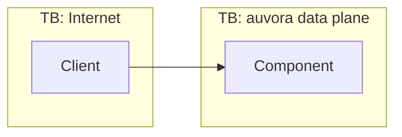

# Threat model: <feature>

- **Status:** Draft | Reviewed | Superseded
- **Date:** YYYY-MM-DD
- **Owner:** <name / role>
- **Governing ADRs:** [ADR-0049](../adr/0049-threat-modelling-method.md), <feature ADRs>
- **Related code:** `crates/<crate>`, `apps/<app>`
- **Processes PII?** yes/no. If yes, the LINDDUN section is mandatory ([data classification](../security/data-classification.md)).

## 1. Scope

What is in scope (components, flows, endpoints, phase), and what is explicitly out of scope with a link to the model that covers it.

## 2. Assets

| Asset | Classification ([data-classification](../security/data-classification.md)) | Why it matters |
|---|---|---|
| <e.g. refresh-token family> | verifier-only / reversible / pii=direct … | |

## 3. Actors and trust boundaries

| Actor | Trust level | Entry points |
|---|---|---|
| <anonymous internet user> | untrusted | |

## 4. STRIDE

Score = likelihood (1–5) × impact (1–5). A score of **≥ 15 is High** and needs a mitigation and a test before merge (ADR-0049 §3).

| ID | Category | Threat | L | I | Score | Mitigation (ADR / control) | Test ID |
|---|---|---|---|---|---|---|---|
| S-1 | Spoofing | | | | | | `abuse::<feature>::<case>` |
| T-1 | Tampering | | | | | | |
| R-1 | Repudiation | | | | | | |
| I-1 | Information disclosure | | | | | | |
| D-1 | Denial of service | | | | | | |
| E-1 | Elevation of privilege | | | | | | |

## 5. LINDDUN (required when PII is processed)

| ID | Category | Threat | L | I | Score | Mitigation | Test ID |
|---|---|---|---|---|---|---|---|
| L-1 | Linking | | | | | | |
| Id-1 | Identifying | | | | | | |
| Nr-1 | Non-repudiation (privacy) | | | | | | |
| De-1 | Detecting | | | | | | |
| Dd-1 | Data disclosure | | | | | | |
| U-1 | Unawareness | | | | | | |
| Nc-1 | Non-compliance | | | | | | |

## 6. Abuse cases

Choose the relevant cases from the seed catalog in [plan §26](../product/plan.md) and the [platform model](platform.md) §6. Add feature-specific ones.

| Abuse case | Applies? | Covered by threat ID(s) |
|---|---|---|
| | | |

## 7. Mitigations → tests

Every mitigation above links to a test in the security regression suite (ADR-0106). CI verifies that these test IDs exist.

| Mitigation | Test ID | Status (planned / implemented) |
|---|---|---|
| | `abuse::<feature>::<case>` | |

## 8. Residual risk

| Risk | Score | Why accepted | Revisit trigger |
|---|---|---|---|
| | | | |

## 9. Review sign-off

| Date | Reviewer | Scope of review | Outcome |
|---|---|---|---|
| | | Initial model / phase exit / pre-pentest / post-incident | Approved / changes requested |
