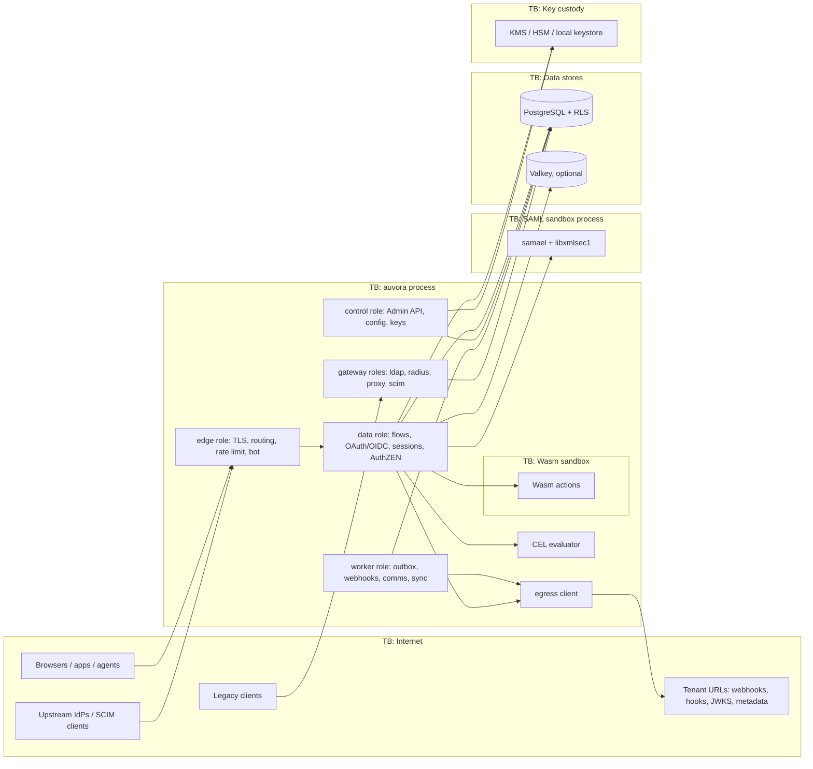

# Threat model: Auvora platform

- **Status:** Draft
- **Date:** 2026-11-01
- **Owner:** Kamaal Khan (owner)
- **Governing ADRs:** [ADR-0049](../adr/0049-threat-modelling-method.md), [ADR-0005](../adr/0005-modular-monolith-single-binary-roles.md), [ADR-0017](../adr/0017-tenancy-isolation-postgres-rls.md), [ADR-0011](../adr/0011-key-custody-keyprovider.md), [ADR-0046](../adr/0046-ci-and-supply-chain-security.md), [ADR-0103](../adr/0103-outbound-egress-ssrf-protection.md)
- **Related code:** all of `crates/`. This model covers system-wide threats. Feature models refine it.
- **Processes PII?** yes, so LINDDUN applies (§5).

## 1. Scope

**In scope:**
- the `auvora` binary and all of its roles (ADR-0005);
- PostgreSQL;
- optional Valkey, NATS and KMS/HSM;
- outbound egress;
- the extension runtimes: hooks, CEL and Wasm;
- the SAML sandbox worker;
- protocol gateways (LDAP, RADIUS, proxy);
- the admin, insider and operator surface;
- the build and release supply chain;
- key custody;
- cell routing.

**Out of scope here:** protocol-specific details (OAuth, SAML, WebAuthn, SCIM, support access, agents). Those get their own models in `docs/threat-models/<feature>.md`, created in the phase that implements them.

## 2. Assets

| Asset | Classification | Why it matters |
|---|---|---|
| Signing/encryption keys, root KEK, DEKs | Key material ([data-classification](../security/data-classification.md) §2) | Compromise allows forging any token or assertion, or decrypting all secrets |
| Credentials (password verifiers, passkeys, TOTP seeds, recovery codes) | Verifier-only / reversible | Account takeover |
| Sessions, refresh-token families, authorization codes | Verifier-only | Session hijack and persistence |
| Token Vault upstream tokens | Reversible | Access to customers' third-party accounts |
| Identity data (profiles, identifiers, memberships) | PII `direct` / `indirect` / `sensitive` | Privacy breach and regulatory exposure |
| Tenant configuration (clients, connections, policies, hooks) | Integrity-critical | Silent takeover of a whole project |
| Audit log and hash chain | Integrity-critical | Loss of accountability; forensics impossible |
| Build artifacts and release signing keys | Integrity-critical | Every installation compromised |

## 3. Actors and trust boundaries

| Actor | Trust level | Entry points |
|---|---|---|
| End user / anonymous internet client | Untrusted | Edge: Flow API, OAuth/OIDC, SAML, hosted UI |
| Relying party / OAuth client / agent | Untrusted, authenticated per request | Token, introspection, PAR, DCR, AuthZEN endpoints |
| Tenant admin / developer | Partially trusted, scoped to a tenant | Admin API, console, CLI, Terraform |
| Customer IT admin | Partially trusted, scoped to an org | Org Admin Portal (time-limited link) |
| Legacy client (VPN, app) | Untrusted | LDAP and RADIUS gateways, proxy |
| Tenant-supplied code and URLs | **Untrusted** | Hooks, Wasm actions, CEL, webhooks, discovery/JWKS/metadata URLs |
| Upstream IdP / directory | Semi-trusted per connection | SAML/OIDC responses, SCIM requests, LDAP sync |
| Platform operator / Cloud staff | Privileged; must be accountable | Platform role, infrastructure (ADR-0055, ADR-0057) |
| Dependency authors / CI | Untrusted inputs to the build | Crates, npm packages, actions (ADR-0046) |

## 4. STRIDE

Score = L × I. A score ≥ 15 is High.

| ID | Category | Threat | L | I | Score | Mitigation | Test ID |
|---|---|---|---|---|---|---|---|
| S-1 | Spoofing | Forged tokens via stolen or weak signing keys, `alg` confusion or `none` | 2 | 5 | 10 | ADR-0012, ADR-0031, ADR-0082 (alg pinned per key, allowlist, KMS custody) | `abuse::jose::alg_confusion` |
| S-2 | Spoofing | Workload/agent identity spoofing via an untrusted federated issuer | 3 | 5 | 15 | ADR-0092 (CEL trust policies, per-issuer trust), ADR-0091 | `abuse::workload::untrusted_issuer` |
| S-3 | Spoofing | Pre-account-takeover; unverified IdP email ("nOAuth"); email-change takeover | 4 | 5 | 20 | ADR-0034 (no silent linking), ADR-0075 (72 h revert link) | `abuse::linking::pre_ato`, `abuse::linking::unverified_idp_email` |
| S-4 | Spoofing | AiTM phishing proxies, MFA fatigue, SIM swap | 4 | 4 | 16 | ADR-0050 (AAL, phishing-resistant policy), ADR-0056 (number matching), ADR-0032 (DBSC), ADR-0097 | `abuse::mfa::push_fatigue`, `abuse::authn::downgrade` |
| T-1 | Tampering | **Cross-tenant data access** via a missing tenant filter | 3 | 5 | 15 | ADR-0017 (RLS on every table, per-transaction role, `PlatformScope`) | `abuse::tenancy::cross_project_rls` (every query path) |
| T-2 | Tampering | Tampering with audit history | 2 | 5 | 10 | ADR-0039 (hash chain, signed checkpoints, WORM) | `abuse::audit::chain_tamper` |
| T-3 | Tampering | SAML XML signature wrapping / parser abuse | 3 | 5 | 15 | ADR-0014 (sandboxed worker, verified subtree only, fuzzing) | `abuse::saml::xsw` |
| T-4 | Tampering | Open redirect, wildcard redirect URIs, loopback abuse | 4 | 4 | 16 | ADR-0085 (exact match, loopback IPs only) | `abuse::oauth::redirect_uri` |
| T-5 | Tampering | `act`-chain forgery; agent delegation escalation | 3 | 5 | 15 | ADR-0086 (depth cap, `may_act`), ADR-0091 | `abuse::delegation::act_forgery` |
| T-6 | Tampering | Clickjacking, CSRF on flows, CORS misconfiguration, cache poisoning on the hosted UI | 3 | 4 | 12 | ADR-0068 (CSP, frame-ancestors), ADR-0067 (flow CSRF) | `abuse::hosted_ui::clickjack`, `abuse::flows::csrf` |
| R-1 | Repudiation | An admin or operator denies a configuration change | 3 | 4 | 12 | ADR-0039 (actor + `act` chain in audit), ADR-0071 (entity history) | `abuse::audit::actor_recorded` |
| R-2 | Repudiation | Support agent acts silently as a user | 2 | 5 | 10 | ADR-0094 (actor preserved, customer-visible ledger) | `abuse::support::silent_actor` |
| I-1 | Info disclosure | **SSRF** through tenant URLs (discovery, JWKS, SAML metadata, webhooks, `logo_uri`, `jwks_uri`, `request_uri`), DNS rebinding, cloud IMDS | 4 | 5 | 20 | ADR-0103 (single egress client, public-only, IP pinning, no IMDS route) | `abuse::egress::private_range`, `abuse::egress::rebinding` |
| I-2 | Info disclosure | Account enumeration and timing leaks | 4 | 3 | 12 | ADR-0035 (uniform responses, 250 ms floor), constant-time compares | `abuse::authn::enumeration_timing` |
| I-3 | Info disclosure | Secrets or PII in logs and traces | 3 | 4 | 12 | ADR-0040 (`Redacted<T>`, `#[sensitive]`), ADR-0072 tags | `abuse::observability::no_secrets_logged` |
| I-4 | Info disclosure | Token Vault exfiltration; DB or backup exfiltration | 2 | 5 | 10 | ADR-0072 (envelope encryption, per-principal DEK), ADR-0011, ADR-0091 | `abuse::vault::db_dump_unreadable` |
| I-5 | Info disclosure | XS-leaks on login pages; consent phishing via third-party apps | 3 | 3 | 9 | ADR-0068, ADR-0053 (unverified-publisher warnings) | `abuse::consent::unverified_publisher` |
| D-1 | DoS | Argon2 CPU exhaustion | 4 | 4 | 16 | ADR-0028 (hash semaphore, fast 429), ADR-0074 | `abuse::authn::argon2_exhaustion` |
| D-2 | DoS | SMS pumping / toll fraud; email bombing | 4 | 3 | 12 | ADR-0036 (spend caps, geo allowlist), ADR-0074, ADR-0037 | `abuse::comms::sms_pumping` |
| D-3 | DoS | ReDoS; CEL or Wasm resource exhaustion | 3 | 4 | 12 | Rust `regex` only, ADR-0016 (cost limits), ADR-0081 (fuel/memory/time caps) | `abuse::cel::cost_limit`, `abuse::wasm::fuel` |
| D-4 | DoS | Cache outage → replay protection silently fails open | 2 | 5 | 10 | ADR-0073 (fail closed, `noeviction`, epoch) | `abuse::state::cache_outage_fail_closed` |
| E-1 | Elevation | Tenant-admin escalation into other tenants or the platform | 3 | 5 | 15 | ADR-0055 (scoped roles, platform AAL3), ADR-0017 | `abuse::admin::tenant_escalation` |
| E-2 | Elevation | Support-session pivoting or escalation beyond `target ∩ agent ∩ policy` | 2 | 5 | 10 | ADR-0094 | `abuse::support::pivot` |
| E-3 | Elevation | Extension code bypassing credential checks, signing or audit | 2 | 5 | 10 | ADR-0038 (invariants: add, deny or require-more only), ADR-0081 sandbox | `abuse::hooks::cannot_bypass` |
| E-4 | Elevation | Insider/operator abuse of platform access | 2 | 5 | 10 | ADR-0057 (Cloud staff only via Supervised Support Access), ADR-0055 dual control | `abuse::admin::operator_access_audited` |
| E-5 | Elevation | Supply-chain compromise (crate, npm package, action, build) | 3 | 5 | 15 | ADR-0046 (cargo-vet/deny, pinned actions, SLSA L3, signed releases), ADR-0012 bans | CI `supply-chain` job; `abuse::supply_chain::banned_crates` |
| E-6 | Elevation | Key compromise (signing key, KEK) | 2 | 5 | 10 | ADR-0082 (emergency rotation + SSF), ADR-0011, runbook (ADR-0108) | `abuse::keys::emergency_rotation` |
| E-7 | Elevation | Refresh-token family theft; DPoP proof replay; authorization code replay | 3 | 5 | 15 | ADR-0030 (rotation, family revocation), ADR-0073 (single-use, fail closed), DPoP `jti` | `abuse::oauth::refresh_reuse`, `abuse::oauth::dpop_replay` |
| E-8 | Elevation | Authentication downgrade (passkey → SMS fallback) | 3 | 4 | 12 | ADR-0050, ADR-0078 (stronger-recovery rule) | `abuse::authn::downgrade` |

## 5. LINDDUN

| ID | Category | Threat | L | I | Score | Mitigation | Test ID |
|---|---|---|---|---|---|---|---|
| L-1 | Linking | Correlating one user across relying parties via `sub` | 3 | 3 | 9 | ADR-0018 (pairwise `sub` option, per-project IDs), ADR-0027 | `abuse::privacy::pairwise_sub` |
| Id-1 | Identifying | Re-identification from audit/history after erasure | 2 | 4 | 8 | ADR-0039 §7 (sidecar + crypto-shred), ADR-0054 | `abuse::privacy::erasure_unrecoverable` |
| Nr-1 | Non-repudiation | Users unable to deny actions because over-detailed device data is retained | 2 | 2 | 4 | ADR-0097 (hashed signals, no raw fingerprints), ADR-0109 retention | — |
| De-1 | Detecting | Inferring account existence across tenants | 2 | 3 | 6 | ADR-0027 (per-project pools), ADR-0035 | `abuse::authn::enumeration_timing` |
| Dd-1 | Data disclosure | PII crossing cells or regions | 2 | 4 | 8 | ADR-0019 (home cell), ADR-0072 residency checks | `abuse::privacy::residency_sink_block` |
| U-1 | Unawareness | Users unaware of support access or agent delegations | 3 | 3 | 9 | ADR-0094 ledger, ADR-0091 account-portal revocation, ADR-0079 | — |
| Nc-1 | Non-compliance | DSAR/erasure obligations missed | 2 | 4 | 8 | ADR-0079, ADR-0054, ADR-0072 tags | `abuse::privacy::dsar_complete` |

## 6. Abuse-case catalog (seed, plan §26)

Each case in the left column must keep a regression test. Feature models inherit these.

| Abuse case | Threat ID(s) |
|---|---|
| SSRF via tenant URLs (discovery, JWKS, metadata, webhooks, logo/jwks/request URIs) | I-1 |
| Pre-account-takeover; unverified IdP email; email-change takeover | S-3 |
| MFA fatigue, SIM swap, AiTM proxies | S-4 |
| Open redirect, redirect-URI wildcards, loopback abuse, consent phishing | T-4, I-5 |
| Clickjacking, CORS, CSRF on flows, XS-leaks, cache poisoning | T-6, I-5 |
| Unicode confusables, normalization collisions (ADR-0075), timing attacks | S-3, I-2 |
| SMS pumping, email bombing, Argon2 exhaustion, ReDoS, CEL/Wasm exhaustion | D-1, D-2, D-3 |
| Tenant-admin escalation, cross-project data access, insider/operator abuse | E-1, T-1, E-4 |
| Supply chain; backup exfiltration | E-5, I-4 |
| Authentication downgrade, refresh-token family theft, DPoP replay, `act`-chain forgery, support-session pivoting, agent delegation escalation, Token Vault exfiltration | E-8, E-7, T-5, E-2, I-4 |
| Key compromise | E-6 |
| SAML signature wrapping/replay | T-3 |
| Cache outage and stale authorization state | D-4 |

## 7. Mitigations → tests

Status for every test ID above: **planned**. Each test is implemented in the phase that delivers the mitigating component (plan §27). The P0 deliverable is the RLS isolation property-test harness (`abuse::tenancy::cross_project_rls`).

## 8. Residual risk

| Risk | Score | Why accepted | Revisit trigger |
|---|---|---|---|
| libxmlsec1 (C) memory-safety bugs in SAML | 10 | Isolated in a sandbox process; mature library; JVM fallback defined (ADR-0014) | A critical CVE or more than 2 interop failures (ADR-0014) |
| A platform operator with DB and KMS access can read secrets | 10 | Inherent to self-hosting; mitigated by audit and dual control in Cloud | A Cloud insider incident; HSM-backed per-tenant KEKs (EE) |
| Wasm runtime escape | 10 | wasmtime is hardened; no WASI fs/net; external review before GA of Wasm actions (P8) | A wasmtime security advisory |

## 9. Review sign-off

| Date | Reviewer | Scope of review | Outcome |
|---|---|---|---|
| 2026-11-01 | — | Initial draft (P0) | Pending owner review |
